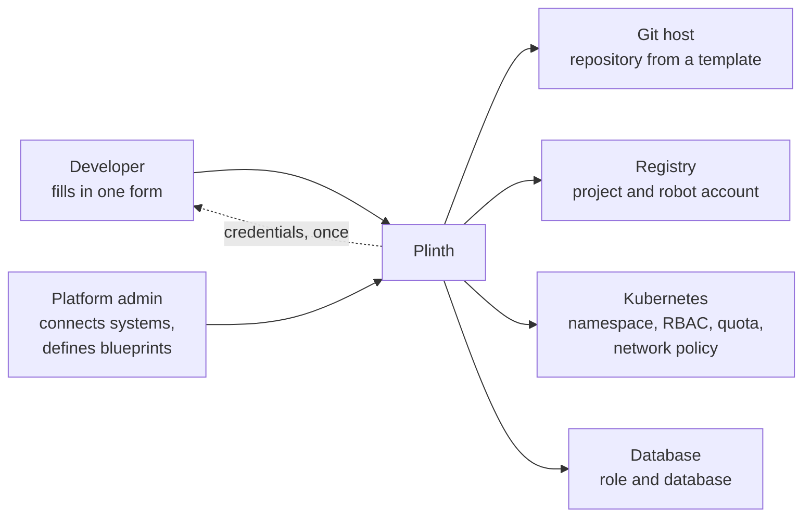

<p align="center"></p>

# Plinth

**Self-service project onboarding for platform teams.** A developer fills in one form. Plinth creates the Git
repository (from your golden template), the container registry project, the Kubernetes namespace (with RBAC, quota and
network isolation) and the database, hands over the credentials once, and shows progress as it goes.

[](https://github.com/getplinth/plinth/actions/workflows/ci.yml)
[](LICENSE)


> **Status: pre-1.0.** It works and is tested end to end against real systems (Gitea, Harbor, Kubernetes, PostgreSQL), but
> the API, configuration and schema can still change before 1.0; breaking changes are listed in the [changelog](CHANGELOG.md).
> It holds administrative credentials, so read [SECURITY.md](SECURITY.md) before you run it for real.



## Why

Onboarding a team usually means a ticket, a wait, and a checklist someone follows by hand or a script only one person understands.
Plinth turns that into a request that anyone on the team can make and that always produces the same result:

- **Idempotent and resumable.** Every step can run twice or be picked up after a crash. A failed request keeps what it finished
  and a retry continues from the step that failed.
- **Secrets are handled carefully.** Credentials for the systems you connect are encrypted at rest (and the master key can be
  rotated without downtime). Credentials created for a project are delivered once and never stored, logged or returned later.
- **Product-neutral core.** "Git host", "registry", "cluster" and "database" are interfaces; products are drivers behind them.
- **Built for teams and control.** Teams with owners and members, invitations, approval for sensitive blueprints (nobody approves their
  own request), quota tiers, an audit log, and notifications by e-mail and webhook.
- **Works without an identity provider, and with any.** Password sign-in out of the box; add any OpenID Connect provider in the
  control panel when you are ready.

## Supported systems

| | Supported today | Wanted (see the [roadmap](docs/roadmap.md)) |
|---|---|---|
| Git host | [Gitea](docs/drivers/gitea.md) | GitHub, GitLab, Bitbucket |
| Registry | [Harbor](docs/drivers/harbor.md) | Azure Container Registry, ECR, Artifact Registry |
| Cluster | [Kubernetes](docs/drivers/kubernetes.md) (any distribution) | |
| Database | [PostgreSQL](docs/drivers/postgres.md) | MySQL / MariaDB |
| Sign-in | passwords, any OpenID Connect provider | |

Adding a driver is the most useful contribution you can make: see [Contributing](CONTRIBUTING.md#writing-a-driver).

## Try it

You need Docker (and, for the second, [k3d](https://k3d.io), `kubectl`, Go and Node).

```bash
make demo      # the real interface with simulated systems, in seconds
make stack     # a complete local stack on real systems, kept running: Gitea, Kubernetes, PostgreSQL, Mailpit, Plinth
               #   HARBOR=1 and KEYCLOAK=1 add a real registry and a real identity provider
```

[docs/stack.md](docs/stack.md) says what runs where and what to try: request a project and watch a repository, a namespace and a
database appear, read the e-mail Plinth sends, invite a colleague, approve a request.

## Install on Kubernetes

```bash
helm install plinth deploy/helm/plinth --namespace platform \
  --set database.existingSecret=plinth-database \
  --set masterKey.existingSecret=plinth-master-key
```

You bring a PostgreSQL database and two Secrets; the chart creates the first administrator and prints how to sign in. No identity
provider is needed to start. See [docs/deploy.md](docs/deploy.md). Versioned images and charts are published to `ghcr.io` with each
release ([docs/releasing.md](docs/releasing.md)); until the first release, build the image yourself with `docker build -t plinth .`.

## Concepts

- **Integration**: a configured external system, such as a Gitea instance or a cluster.
- **Driver**: the code behind an integration (`gitea`, `harbor`, `kubernetes`, `postgres`).
- **Blueprint**: a combination of integrations with defaults, which developers pick by name. It can require approval.
- **Request**: a developer's order for one team and its projects; it expands into idempotent, resumable steps.
- **Team**: who may request under a name. Owners manage the people; members request together and see each other's requests.

## Documentation

[Architecture](docs/architecture.md) · [Deploying on Kubernetes](docs/deploy.md) · [Web interface](docs/ui.md) ·
[API, configuration and operation](docs/api.md) · [Onboarding flow](docs/onboarding.md) · [Local stack](docs/stack.md) ·
[Drivers](docs/drivers) · [Roadmap](docs/roadmap.md) · [Where Plinth came from](docs/legacy-mapping.md)

## Develop

```bash
make test          # Go and web unit tests
make itest-app     # the whole application on a disposable PostgreSQL (needs Docker)
make itest         # all integration tests: application, Kubernetes, PostgreSQL, Gitea, Harbor
make e2e           # one request through every real driver (slow)
make lint          # go vet and gofmt
./bin/plinth genkey    # create a PLINTH_MASTER_KEY
```

Configuration is by `PLINTH_*` environment variables, listed in [docs/api.md](docs/api.md).

```
cmd/plinth/             the server
cmd/plinth-demo/        the demo (simulated systems), cmd/devidp: a development identity provider for tests
internal/api/           REST API
internal/auth/          passwords, sessions, OpenID Connect verification across providers
internal/provider/      the driver interfaces and their implementations (gitea, harbor, kubernetes, postgres)
internal/onboarding/    what a request expands into
internal/orchestrator/  the step runner: retry, resume, redaction of credentials
internal/store/         PostgreSQL access and migrations
internal/notify/        e-mail and webhook notifications
internal/crypto/        envelope encryption and master key rotation
web/                    the React interface (embedded in the binary)
deploy/helm/plinth/     the Helm chart
docs/                   documentation (diagrams are Mermaid)
scripts/                integration and end-to-end tests, the local stack, repository checks
```

## Contributing, community, security

Contributions are welcome: read [CONTRIBUTING.md](CONTRIBUTING.md) (commits are signed off under the
[DCO](DCO)), and the [Code of Conduct](CODE_OF_CONDUCT.md). Ask questions in
[Discussions](https://github.com/getplinth/plinth/discussions). How decisions are made is in [GOVERNANCE.md](GOVERNANCE.md).
Report vulnerabilities **privately**, as described in [SECURITY.md](SECURITY.md).

## Licence

Apache License 2.0, see [LICENSE](LICENSE) and [NOTICE](NOTICE). Third-party components, including the bundled fonts, are listed
in [THIRD_PARTY_NOTICES.md](THIRD_PARTY_NOTICES.md).
