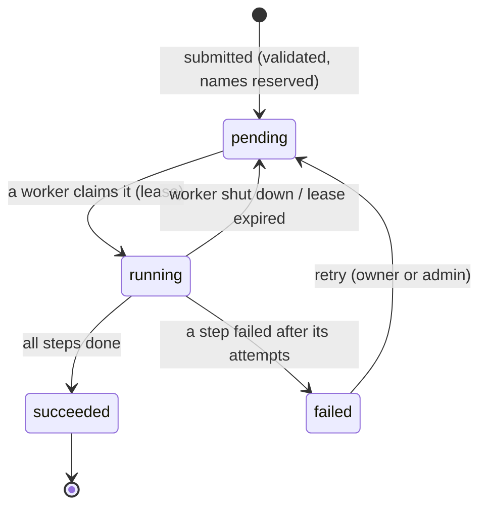

# API and operation

Plinth is a single binary: REST API plus background workers, backed by PostgreSQL. It has no user database; people sign in with your identity provider.

## Configuration

| Variable | Required | Meaning |
|---|---|---|
| `PLINTH_DATABASE_URL` | yes | PostgreSQL connection URL. Migrations run at start. |
| `PLINTH_MASTER_KEY` | yes | 32 random bytes, base64. Encrypts integration credentials at rest. Create one with `plinth genkey`; inject it from a secret manager. **Losing it makes stored integrations unreadable.** |
| `PLINTH_OIDC_ISSUER` | yes | issuer URL of your identity provider; must be `https` |
| `PLINTH_OIDC_AUDIENCE` | yes | client id the tokens are issued for |
| `PLINTH_ADMIN_GROUP` | no | members of this group are administrators (default `plinth-admins`) |
| `PLINTH_GROUPS_CLAIM` | no | token claim that lists groups (default `groups`) |
| `PLINTH_WORKERS` | no | concurrent request workers, 1 to 32 (default 2) |
| `PLINTH_LISTEN_ADDR` | no | default `:8080` |
| `PLINTH_OIDC_ALLOW_HTTP` | no | `true` allows an `http` issuer (local testing only) |

All configuration problems are reported together at startup, and secrets are never printed.

## Authentication and roles

Every call except health and version needs `Authorization: Bearer <JWT>` from your identity provider. The token must be signed by the issuer's published keys, unexpired, and issued for `PLINTH_OIDC_AUDIENCE`. Bad tokens get a plain `401 invalid token` without saying why; the reason goes to the server log only.

| Role | Who | Can |
|---|---|---|
| `admin` | members of `PLINTH_ADMIN_GROUP` | manage integrations and blueprints, read the audit log, see and retry anyone's requests |
| `user` | everyone else | list blueprints (as a summary), submit requests, see and retry **their own** requests |

The role is refreshed from the token on every call, so removing someone from the admin group takes effect at once.

## Endpoints

| Method and path | Who | Purpose |
|---|---|---|
| `GET /healthz`, `/readyz`, `/api/v1/version` | anyone | liveness, readiness (database), version |
| `GET /api/v1/me` | user | who am I |
| `GET /api/v1/integrations`, `POST` | admin | list / create a configured system (`kind`, `driver`, `name`, `config`) |
| `GET`, `PUT`, `DELETE /api/v1/integrations/{name}` | admin | read key names / replace config / delete (409 while a blueprint uses it) |
| `POST /api/v1/integrations/{name}/validate` | admin | contact the system with the stored config; returns `ok` or `error` |
| `GET /api/v1/blueprints`, `GET /{name}` | user | admins see everything; users see name, environments, whether a database and registry exist |
| `POST`, `PUT /{name}`, `DELETE /{name}` | admin | manage blueprints |
| `GET /api/v1/quota-tiers` | user | available tiers |
| `POST /api/v1/requests` | user | submit `{blueprint, tenant, projects[]}`; returns `202` and the request |
| `GET /api/v1/requests`, `GET /{id}` | user | own requests (`?all=true` for admins); status, per-step state, outputs |
| `POST /api/v1/requests/{id}/retry` | owner or admin | re-queue a failed request; finished steps are not repeated |
| `GET /api/v1/audit` | admin | who did what |

## Request lifecycle

A worker claims a request with a lease (`FOR UPDATE SKIP LOCKED`) and refreshes it each time it saves progress. If the worker dies the lease expires and another worker resumes from the saved state. A worker that loses its lease stops without recording an outcome. On shutdown, running requests are handed back at once.

## Security properties

- **Credentials of external systems** are envelope-encrypted (a per-record key, wrapped by the master key, bound to the row). They are decrypted only by workers and the validate endpoint, and never returned: the API shows key *names* only. A ciphertext copied to another row does not decrypt.
- **Credentials created for projects** (registry, database) are never stored. They go straight to their destinations; the request state, API responses and audit log contain none. Tests scan the database for them.
- **Tenant ownership.** The first request for a tenant makes the requester its owner. Others are refused (403) unless they are admins, so nobody can add projects to another team's tenant.
- **Name collisions.** Derived names (namespace, registry project) are globally unique; tenant `a-b` + project `c` and tenant `a` + project `b-c` would collide, so the second is refused (409) before anything is provisioned.
- **Other people's requests** return 404, not 403, so their existence is not revealed.
- Strict JSON (unknown fields rejected), 1 MiB body limit, per-user rate limit on submit and retry (burst 5, 10 per minute), `no-store` and restrictive headers on all responses, and request logs that never contain tokens, bodies or query strings.
- Every administrative change and request transition is written to the audit log. Details never contain secrets.

## Web interface

The server also serves the web app for every non-API path; see [ui.md](ui.md). Public endpoints for it: `GET /api/v1/config` returns the identity provider and client id the browser signs in with. Admins also have `GET /api/v1/drivers` (the drivers compiled in).

## Not built yet

Approval step for sensitive blueprints, tenant members beyond the owner, quota tier management endpoints, releasing a name reserved by a request that never succeeded, and a Helm chart.

## Tests

`make itest-app` runs the whole application on a disposable PostgreSQL with a fake identity provider and fake drivers: authentication, roles, integration and blueprint management, encryption at rest, validation, background execution, secrets never leaking, tenant ownership, name collisions, failure and retry, rate limiting, body limits, audit, lease takeover, and exactly-once claiming under concurrency.
