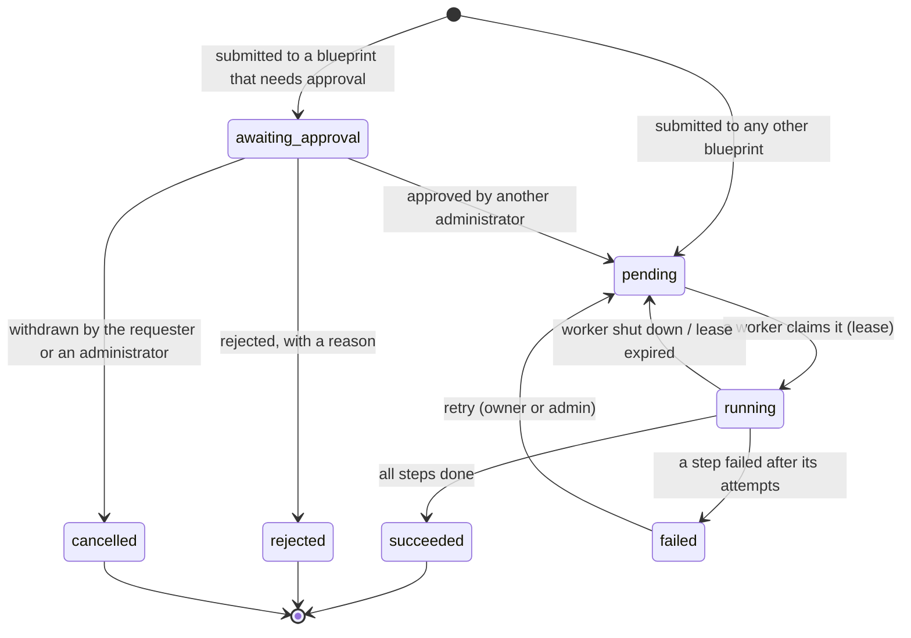
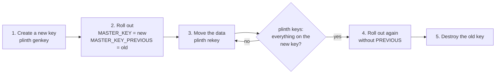

# API and operation

Plinth is a single binary: REST API plus background workers, backed by PostgreSQL. It has no user database; people sign in with your identity provider.

## Configuration

| Variable | Required | Meaning |
|---|---|---|
| `PLINTH_DATABASE_URL` | yes | PostgreSQL connection URL. Migrations run at start. |
| `PLINTH_MASTER_KEY` | yes | 32 random bytes, base64. Encrypts integration credentials at rest. Create one with `plinth genkey`; inject it from a secret manager. **Losing it makes stored integrations unreadable.** |
| `PLINTH_OIDC_ISSUER` | yes | issuer URL of your identity provider; must be `https` |
| `PLINTH_OIDC_AUDIENCE` | yes | client id the tokens are issued for |
| `PLINTH_ADMIN_GROUP` | no | members of this group are administrators (default `plinth-admins`) |
| `PLINTH_GROUPS_CLAIM` | no | token claim that lists groups (default `groups`) |
| `PLINTH_MASTER_KEY_PREVIOUS` | no | former master key(s), comma separated, only while [rotating](#rotating-the-master-key). Read-only: nothing new is encrypted with them |
| `PLINTH_WORKERS` | no | concurrent request workers, 1 to 32 (default 2) |
| `PLINTH_LISTEN_ADDR` | no | default `:8080` |
| `PLINTH_OIDC_ALLOW_HTTP` | no | `true` allows an `http` issuer (local testing only) |
| `PLINTH_TRUST_UNVERIFIED_EMAIL` | no | `true` accepts e-mail addresses the provider did not mark `email_verified`, for team invitations and add-by-email. Off by default; see Teams |

All configuration problems are reported together at startup, and secrets are never printed.

## Authentication and roles

Every call except health and version needs `Authorization: Bearer <JWT>` from your identity provider. The token must be signed by the issuer's published keys, unexpired, and issued for `PLINTH_OIDC_AUDIENCE`. Bad tokens get a plain `401 invalid token` without saying why; the reason goes to the server log only.

| Role | Who | Can |
|---|---|---|
| `admin` | members of `PLINTH_ADMIN_GROUP` | manage integrations and blueprints, read the audit log, see and retry anyone's requests |
| `user` | everyone else | list blueprints (as a summary), submit requests, see and retry **their own** requests |

The role is refreshed from the token on every call, so removing someone from the admin group takes effect at once.

## Endpoints

| Method and path | Who | Purpose |
|---|---|---|
| `GET /healthz`, `/readyz`, `/api/v1/version` | anyone | liveness, readiness (database), version |
| `GET /api/v1/me` | user | who am I |
| `GET /api/v1/integrations`, `POST` | admin | list / create a configured system (`kind`, `driver`, `name`, `config`) |
| `GET`, `PUT`, `DELETE /api/v1/integrations/{name}` | admin | read key names / replace config / delete (409 while a blueprint uses it) |
| `POST /api/v1/integrations/{name}/validate` | admin | contact the system with the stored config; returns `ok` or `error` |
| `GET /api/v1/blueprints`, `GET /{name}` | user | admins see everything; users see name, environments, whether a database and registry exist |
| `POST`, `PUT /{name}`, `DELETE /{name}` | admin | manage blueprints |
| `GET /api/v1/quota-tiers` | user | available tiers |
| `POST /api/v1/requests` | user | submit `{blueprint, tenant, projects[]}`; returns `202` and the request |
| `GET /api/v1/requests`, `GET /{id}` | user | your requests and your teams' (`?all=true` for admins; `?status=awaiting_approval` filters); status, per-step state, outputs, and the decision |
| `GET /api/v1/tenants`, `GET /{name}` | user | teams you belong to (`?all=true` for admins), and one team with its members and projects |
| `POST /api/v1/tenants/{name}/members` | owner, admin | add a person by e-mail (`email`, `role`): `201` and the member if they have an account, `202` and an invitation if not |
| `DELETE /api/v1/tenants/{name}/invitations/{id}` | owner, admin | revoke an open invitation (`204`) |
| `PUT`, `DELETE /api/v1/tenants/{name}/members/{user}` | owner, admin (anyone can DELETE themselves) | change a role / remove or leave |
| `POST /api/v1/requests/{id}/retry` | owner or admin | re-queue a failed request; finished steps are not repeated |
| `POST /api/v1/requests/{id}/approve` | admin, never the requester | release a request that is awaiting approval (optional `note`) |
| `POST /api/v1/requests/{id}/reject` | admin | refuse it; a `note` of at least 3 characters is required |
| `POST /api/v1/requests/{id}/cancel` | owner or admin | withdraw a request that is awaiting approval |
| `GET /api/v1/audit` | admin | who did what |

## Request lifecycle

A worker claims a request with a lease (`FOR UPDATE SKIP LOCKED`) and refreshes it each time it saves progress. If the worker dies the lease expires and another worker resumes from the saved state. A worker that loses its lease stops without recording an outcome. On shutdown, running requests are handed back at once.

## Teams

A team (tenant) has **owners** and **members**. The first request for a new team name creates it and makes the requester its owner; after that, only people in the team can request for it.

| | administrator | owner | member | everyone else |
|---|---|---|---|---|
| See the team, its people and projects | yes | yes | yes | no (404, as if it did not exist) |
| Request projects for the team | yes | yes | yes | no (403, "ask one of its owners to add you") |
| See the team's requests | yes | yes | yes | no (404) |
| Retry a failed request | yes | yes | yes | no |
| Withdraw a waiting request | yes | yes | only their own | no |
| Add, remove, change roles | yes | yes | no (403); can **leave** | no |
| Approve a request | yes (not their own) | no | no | no |

- **Adding people.** By e-mail address, compared without regard to case. Someone who already has an account is added at once (`201`). Someone who has never signed in gets an **invitation** (`202`): they join, with the invited role, the first time they sign in with that address. Plinth sends no e-mail, so tell them. If two accounts share one address it refuses (409) rather than guess.
- **Invitations.** Open for 30 days, at most 50 per team, one per address (inviting again renews it and can change the role). Only owners and administrators see them. They can be revoked, and an expired one grants nothing.
- **E-mail must be verified.** An address only counts when the identity provider says it verified it (`email_verified`). Otherwise anyone able to register an account with someone else's address at a permissive provider could claim their invitation. An unverified account is never matched by e-mail, so adding it creates an invitation instead; it joins once the provider verifies the address. If your provider only allows addresses it controls but omits the claim, set `PLINTH_TRUST_UNVERIFIED_EMAIL=true` (Helm: `config.oidc.trustUnverifiedEmail`); Plinth logs a warning at startup when it is on. Accounts that existed before invitations count as unverified until their next sign-in.
- **A team always keeps an owner.** The last owner cannot be demoted, removed, or leave (409), not even by an administrator. Two owners removing each other at the same moment still leave one: changes lock the team.
- **Leaving.** Ends access to the team and its requests. What you requested yourself stays visible to you, but you cannot retry or withdraw it any more.
- **Everything is audited**: `tenant.create`, `tenant.member.add`, `.role`, `.remove`, `.leave`, `tenant.invitation.create`, `.accept`, `.revoke`, with the e-mail addresses and roles involved.
- Existing teams keep their owner when upgrading (migration `0003`).

## Approval

A blueprint can be marked **needs approval** (`requires_approval`). Requests for it are validated and stored as usual, but wait in `awaiting_approval`: no worker picks them up and no system is contacted until an administrator approves.

- **Four eyes.** Nobody approves their own request, administrators included (`403`, "another administrator has to"). With a single administrator, such a blueprint cannot be used by that administrator; add a second one.
- **Reasons.** A rejection needs a reason (3 to 500 characters), which the requester sees. Approvals and withdrawals may carry a note. Notes are kept in the audit log, together with who decided.
- **Decided once.** A decision is atomic: if two administrators approve at the same moment, one gets `200` and the other `409`. A decided request cannot be decided again.
- **Names are released.** While a request waits, the names it would create are reserved, as for any request. Rejecting or withdrawing it frees them.
- **What was approved is what runs.** A request's content cannot be edited after submission. The blueprint, however, is read when the request runs, so changing a blueprint between approval and execution changes what is set up; review blueprint changes like any other change.
- **Visibility.** Administrators list the queue with `GET /api/v1/requests?all=true&status=awaiting_approval`. The requester sees the state and the verdict on their own request.

## Security properties

- **Credentials of external systems** are envelope-encrypted (a per-record key, wrapped by the master key, bound to the row). They are decrypted only by workers and the validate endpoint, and never returned: the API shows key *names* only. A ciphertext copied to another row does not decrypt.
- **Credentials created for projects** (registry, database) are never stored. They go straight to their destinations; the request state, API responses and audit log contain none. Tests scan the database for them.
- **Teams.** Only members of a team (and administrators) can request projects for it, so nobody can add projects to another team's name. See *Teams* above.
- **Name collisions.** Derived names (namespace, registry project) are globally unique; tenant `a-b` + project `c` and tenant `a` + project `b-c` would collide, so the second is refused (409) before anything is provisioned.
- **Other people's requests** return 404, not 403, so their existence is not revealed.
- Strict JSON (unknown fields rejected), 1 MiB body limit, per-user rate limit on submit and retry (burst 5, 10 per minute), `no-store` and restrictive headers on all responses, and request logs that never contain tokens, bodies or query strings.
- Every administrative change and request transition is written to the audit log. Details never contain secrets.

## Rotating the master key

Rotate the key when it may have leaked, when someone who knew it leaves, or on a schedule. Plinth uses envelope encryption: each stored credential has its own data key, and the master key only wraps that data key. Rotation therefore re-wraps the small data keys and never touches the encrypted values. It runs while Plinth keeps serving requests, can be repeated, and can be stopped at any point.

1. **Create a key**: `plinth genkey`. Store it where you keep the current one.
2. **Roll out both keys** to every instance: `PLINTH_MASTER_KEY` is the new key and `PLINTH_MASTER_KEY_PREVIOUS` the old one. Instances still on the old key keep working during the rollout, and from now on new and changed credentials use the new key. Do not go on until every instance runs the new configuration: an instance that only knows the old key cannot read what is written with the new one (it says which key is missing).
3. **Move the existing credentials** with the same environment: `plinth rekey` (`--dry-run` shows what would change). Each record is replaced only if it did not change meanwhile, so it is safe next to live traffic and to a second run. A record that cannot be read, for example because its key was left out, is reported and left as it is while the others still move; the command then exits with an error.
4. **Check** with `plinth keys`, which lists how many records use each key and warns about any key that is not configured. When everything is on the new key, roll out again without `PLINTH_MASTER_KEY_PREVIOUS`. At startup Plinth also logs a warning while any record is not on the current key, and an info line when the old key can be removed.
5. **Destroy the old key** everywhere, including backups of the secret store. Old database backups are still encrypted with the old key, so keep it for as long as you may restore one of them.

`plinth keys` and `plinth rekey` need only `PLINTH_DATABASE_URL` and the keys, not the identity provider. In Kubernetes run them as a one-off Job or `kubectl exec` in a running pod. Keys are identified in output by a short fingerprint that does not reveal them. Credentials written before this feature are read as they are and get a key id the first time they are re-wrapped.

## Web interface

The server also serves the web app for every non-API path; see [ui.md](ui.md). Public endpoints for it: `GET /api/v1/config` returns the identity provider and client id the browser signs in with. Admins also have `GET /api/v1/drivers` (the drivers compiled in).

## Not built yet

Quota tier management endpoints and releasing a name reserved by a request that never succeeded.

## Tests

`make itest-app` runs the whole application on a disposable PostgreSQL with a fake identity provider and fake drivers: authentication, roles, integration and blueprint management, encryption at rest, validation, background execution, secrets never leaking, tenant ownership, name collisions, failure and retry, rate limiting, body limits, audit, lease takeover, and exactly-once claiming under concurrency.
