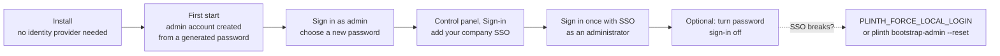
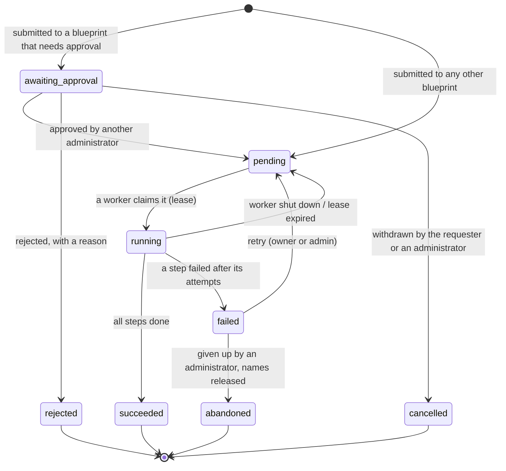
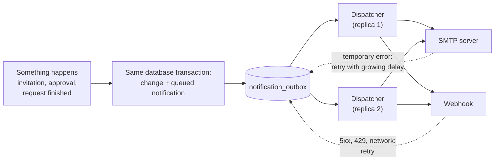
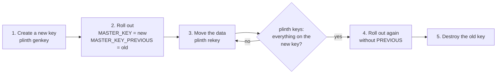

# API and operation

Plinth is a single binary: REST API plus background workers, backed by PostgreSQL. People sign in with a password Plinth keeps, with an identity provider you configure (or both).

## Configuration

| Variable | Required | Meaning |
|---|---|---|
| `PLINTH_DATABASE_URL` | yes | PostgreSQL connection URL. Migrations run at start. |
| `PLINTH_MASTER_KEY` | yes | 32 random bytes, base64. Encrypts integration credentials at rest. Create one with `plinth genkey`; inject it from a secret manager. **Losing it makes stored integrations unreadable.** |
| `PLINTH_BOOTSTRAP_ADMIN_PASSWORD` | no | the first administrator's starting password, used at start only on a fresh installation (no password account and nobody has signed in yet), so upgrading an existing installation never adds an administrator by surprise; it must be changed at first sign-in. `PLINTH_BOOTSTRAP_ADMIN_USERNAME` (default `admin`) names it |
| `PLINTH_FORCE_LOCAL_LOGIN` | no | `true` keeps password sign-in on whatever the control panel says: the way back in when an identity provider stopped working |
| `PLINTH_OIDC_ISSUER`, `PLINTH_OIDC_AUDIENCE` | no | an identity provider fixed at install time (issuer must be `https`, audience is the client id); both or neither. It is shown read-only in the control panel. Usually better to add providers there |
| `PLINTH_OIDC_NAME` | no | how that provider is named on the sign-in page (default `Single sign-on`) |
| `PLINTH_ADMIN_GROUP` | no | members of this group are administrators (default `plinth-admins`) |
| `PLINTH_GROUPS_CLAIM` | no | token claim that lists groups (default `groups`) |
| `PLINTH_MASTER_KEY_PREVIOUS` | no | former master key(s), comma separated, only while [rotating](#rotating-the-master-key). Read-only: nothing new is encrypted with them |
| `PLINTH_WORKERS` | no | concurrent request workers, 1 to 32 (default 2) |
| `PLINTH_LISTEN_ADDR` | no | default `:8080` |
| `PLINTH_OIDC_ALLOW_HTTP` | no | `true` allows an `http` issuer (local testing only) |
| `PLINTH_PUBLIC_URL` | no | the address people open Plinth at, for links in [notifications](#notifications). Without it messages carry no links |
| `PLINTH_SMTP_HOST`, `_PORT`, `_FROM` | no | mail server for e-mail notifications; `_FROM` (a sender such as `Plinth <plinth@example.com>`) is required with the host. Port defaults to 587, or 465 with `_TLS=tls` |
| `PLINTH_SMTP_TLS` | no | `starttls` (default: the connection must upgrade before anything is sent), `tls` (TLS from the start) or `none` (testing only) |
| `PLINTH_SMTP_USERNAME`, `_PASSWORD` | no | mail server login; both or neither |
| `PLINTH_WEBHOOK_URL` | no | receives every notification as JSON; must be `https` |
| `PLINTH_WEBHOOK_SECRET` | no | signs webhook requests, see [Notifications](#notifications) |
| `PLINTH_NOTIFY_ALLOW_INSECURE` | no | `true` allows an `http` webhook or public address and unencrypted mail, for local testing only |
| `PLINTH_TRUST_UNVERIFIED_EMAIL` | no | `true` accepts e-mail addresses the provider did not mark `email_verified`, for team invitations and add-by-email. Off by default; see Teams |

All configuration problems are reported together at startup, and secrets are never printed.

## Authentication and roles

Nothing has to be configured to sign in: Plinth starts with a password account for the first administrator, and an administrator adds identity providers later in the control panel.

Every call except health, version, `GET /config` and `POST /auth/login` needs `Authorization: Bearer <token>`. There are two kinds of token, told apart by their form:

- a **session token** (`plt_...`) from password sign-in. Only its SHA-256 is stored. It ends after 8 hours without use and never lasts longer than 7 days, on sign-out, when the password is changed or reset (the other sessions end), when the account is disabled, or when password sign-in is turned off;
- an **ID token** (a JWT) from an identity provider. It is verified against the provider named in its `iss` claim: signed by that issuer's published keys, unexpired, issued for that provider's client id. Bad tokens get a plain `401 invalid token` without saying why; the reason goes to the server log only.

| Role | Who | Can |
|---|---|---|
| `admin` | a password account with the role, or a member of the provider's administrator group | manage integrations and blueprints, users and sign-in, read the audit log, see and retry anyone's requests |
| `user` | everyone else | list blueprints (as a summary), submit requests, see and retry **their own** requests |

For identity providers the role is refreshed from the token on every call, so removing someone from the administrator group takes effect at once. For password accounts an administrator sets it.

### Password sign-in

`POST /api/v1/auth/login` with `{username, password}` returns `{token, expires_at, must_change_password}`. Usernames are case-insensitive.

- **Passwords** are stored as argon2id hashes (64 MiB, 3 passes), never in clear text, logs or the audit log. At least 12 and at most 128 characters, not containing the username or the e-mail name, not trivially repetitive or common. A password an administrator chose or reset, and the bootstrap one, must be replaced at first sign-in: until then only `GET /me`, `POST /auth/password` and `POST /auth/logout` work (`403` with code `password_change_required`).
- **Guessing is slowed down.** Each username allows a burst of 10 attempts, then one every 6 seconds, and each remote address 30 then one every 2 seconds (`429`). Five wrong passwords in a row lock the account for a minute, doubling per further failure up to 15 minutes; the lockout is audited (`auth.lockout`). A locked, disabled, unknown or wrong sign-in all answer the same `401 invalid username or password`, and an unknown username takes as long to check as a real one, so neither reveals which accounts exist. Behind a reverse proxy every client has the proxy's address, so the per-username limit does the real work; forwarding headers are not trusted.
- `POST /auth/password` (`current_password`, `new_password`) changes your own password; `POST /auth/logout` ends the session.

### Users (password accounts)

Administrators manage them under *Users*: `GET`, `POST /local-users`, `PUT`, `DELETE /local-users/{id}` and `POST /local-users/{id}/reset-password`. Without a password in the request Plinth generates one (20 characters) and returns it **once** as `temporary_password`. An e-mail address given by the administrator is trusted, so team invitations waiting for it are accepted at once. You cannot disable, demote, delete or reset yourself. An account with requests or team memberships on record cannot be deleted, only disabled. Nobody can remove the last password administrator unless an identity provider is configured, and two administrators removing each other at the same moment still leave one.

### Identity providers

Any OpenID Connect provider works (Keycloak, Microsoft Entra ID, Okta, Auth0, Google Workspace, ...). Under *Sign-in* an administrator adds one with `POST /oidc-providers` (`name`, `display_name`, `issuer`, `client_id`, and optionally `scopes`, `groups_claim`, `admin_group`, `trust_unverified_email`, `enabled`). Plinth contacts the issuer when you save, so a wrong address is found then. Several can coexist; each has its own administrator group, and the same subject at two providers is two different people. At the provider, register Plinth as a **public client** (authorization code with PKCE) with the redirect URI `https://<your Plinth address>/callback`; no client secret is involved. Providers from `PLINTH_OIDC_*` are listed read-only and keep their users' original identities.

- **The issuer is checked before Plinth contacts it:** `https`, a host, no credentials, query or fragment, never a link-local address (where cloud metadata lives), and not this machine unless `PLINTH_OIDC_ALLOW_HTTP` is set for local testing. Connections are checked again after name resolution and redirects to other hosts are not followed.
- **A provider that is down does not stop Plinth or the other providers.** Keys are fetched on first use. Changes made through one replica reach the others within seconds, or at once when a token from an unknown issuer arrives.
- **A provider cannot take over a password account.** People who sign in through a provider are keyed by provider and subject, and a subject that looks like a password account (`local:...`) is refused.
- **The browser may only call the providers you configured:** the page's content security policy follows the list.

### Turning password sign-in off, and getting back in

*Sign-in* has a switch for password sign-in. It refuses to turn it off unless an identity provider is enabled **and** an administrator has already signed in through one, which shows that the provider and its administrator group work. Turning it off ends the password sessions. Plinth also refuses to disable or delete the last enabled way to sign in. If the provider breaks anyway:

- set `PLINTH_FORCE_LOCAL_LOGIN=true` (Helm: `config.forceLocalLogin`) and restart: password sign-in works whatever the setting says; or
- run `plinth bootstrap-admin --reset` against the database (it needs only `PLINTH_DATABASE_URL`): it sets a new password for the account named by `--username` or `PLINTH_BOOTSTRAP_ADMIN_USERNAME` (creating it as an administrator if it does not exist), enables and unlocks it, ends its sessions, and requires a new password at the next sign-in. Without `--reset` it creates the first administrator (also on an installation that already has users), or refuses when a password account exists. The password comes from `PLINTH_BOOTSTRAP_ADMIN_PASSWORD` or is generated and printed once.

## Endpoints

| Method and path | Who | Purpose |
|---|---|---|
| `GET /healthz`, `/readyz`, `/api/v1/version` | anyone | liveness, readiness (database), version |
| `GET /api/v1/config` | anyone | what the sign-in page offers: whether password sign-in is on, and the identity providers (id, display name, issuer, client id, scopes) |
| `POST /api/v1/auth/login` | anyone | password sign-in; returns a session token |
| `POST /api/v1/auth/logout`, `/auth/password` | user | end this session / change your own password |
| `GET /api/v1/me` | user | who am I (including `auth_source` and whether the password must be changed) |
| `GET`, `POST /api/v1/local-users`; `PUT`, `DELETE /{id}`; `POST /{id}/reset-password` | admin | password accounts |
| `GET`, `POST /api/v1/oidc-providers`; `PUT`, `DELETE /{id}` | admin | identity providers (the one from the environment is read-only) |
| `GET`, `PUT /api/v1/auth-settings` | admin | password sign-in on or off |
| `GET /api/v1/integrations`, `POST` | admin | list / create a configured system (`kind`, `driver`, `name`, `config`) |
| `GET`, `PUT`, `DELETE /api/v1/integrations/{name}` | admin | read key names / replace config / delete (409 while a blueprint uses it) |
| `POST /api/v1/integrations/{name}/validate` | admin | contact the system with the stored config; returns `ok` or `error` |
| `GET /api/v1/blueprints`, `GET /{name}` | user | admins see everything; users see name, environments, whether a database and registry exist |
| `POST`, `PUT /{name}`, `DELETE /{name}` | admin | manage blueprints |
| `GET /api/v1/quota-tiers` | user | available tiers |
| `PUT /api/v1/quota-tiers/{name}` | admin | create (`201`) or replace (`200`) a tier; every problem is listed at once (`422`) |
| `DELETE /api/v1/quota-tiers/{name}` | admin | delete a tier (`204`); refused (`409`) for `bronze`, the default, and while unfinished requests name the tier |
| `POST /api/v1/requests` | user | submit `{blueprint, tenant, projects[]}`; returns `202` and the request |
| `GET /api/v1/requests`, `GET /{id}` | user | your requests and your teams' (`?all=true` for admins; `?status=awaiting_approval` filters); status, per-step state, outputs, and the decision |
| `GET /api/v1/tenants`, `GET /{name}` | user | teams you belong to (`?all=true` for admins), and one team with its members and projects |
| `POST /api/v1/tenants/{name}/members` | owner, admin | add a person by e-mail (`email`, `role`): `201` and the member if they have an account, `202` and an invitation if not |
| `DELETE /api/v1/tenants/{name}/invitations/{id}` | owner, admin | revoke an open invitation (`204`) |
| `PUT`, `DELETE /api/v1/tenants/{name}/members/{user}` | owner, admin (anyone can DELETE themselves) | change a role / remove or leave |
| `POST /api/v1/requests/{id}/retry` | owner or admin | re-queue a failed request; finished steps are not repeated |
| `POST /api/v1/requests/{id}/approve` | admin, never the requester | release a request that is awaiting approval (optional `note`) |
| `POST /api/v1/requests/{id}/reject` | admin | refuse it; a `note` of at least 3 characters is required |
| `POST /api/v1/requests/{id}/cancel` | owner or admin | withdraw a request that is awaiting approval |
| `POST /api/v1/requests/{id}/release` | admin | give up a failed request and free its names; a `note` of at least 3 characters is required. Nothing it created is removed |
| `GET /api/v1/notifications` | admin | which channels are on and the latest notifications with their state (`waiting`, `sent`, `failed`) and reason |
| `POST /api/v1/notifications/test` | admin | queue a test message to every channel; the e-mail goes to you (`202`; `409` when no channel is configured) |
| `GET /api/v1/audit` | admin | who did what |

## Request lifecycle

A worker claims a request with a lease (`FOR UPDATE SKIP LOCKED`) and refreshes it each time it saves progress. If the worker dies the lease expires and another worker resumes from the saved state. A worker that loses its lease stops without recording an outcome. On shutdown, running requests are handed back at once.

### Names and releasing them

A request reserves the names it will create (team and project, which together give a namespace, registry project and Git path that are unique across all teams) the moment it is submitted. Rejecting or withdrawing a request frees them. A request that **fails** keeps them, because it can be retried and nobody else should take what it half-built.

If a failed request will never be fixed, an administrator can **release** it (the *Give up…* button on the request, or `POST /requests/{id}/release`). The request ends as `abandoned` and the names are free for anyone.

- **Nothing is deleted.** Plinth does not remove the repository, registry project, namespace or database the request had already created, because it cannot tell what is safe to delete. The steps run or tried are shown before confirming and written to the audit entry (`left_in_place`). Clean them up first: the setup steps are idempotent, so a team that later uses the same names adopts whatever is still there, including another team's leftover data.
- **Why only administrators, and why a reason.** Because of the above. The reason (3 to 500 characters) goes in the audit log, with who did it.
- **Only what this request added.** A project that existed before it stays. A name is also kept while another live request of the same team still asks for it (a team that submits again after a failure), and is freed when the last one is given up.
- **Final.** An abandoned request cannot be retried or released again; submit a new one.
- Audited as `request.release`.

## Teams

A team (tenant) has **owners** and **members**. The first request for a new team name creates it and makes the requester its owner; after that, only people in the team can request for it.

| | administrator | owner | member | everyone else |
|---|---|---|---|---|
| See the team, its people and projects | yes | yes | yes | no (404, as if it did not exist) |
| Request projects for the team | yes | yes | yes | no (403, "ask one of its owners to add you") |
| See the team's requests | yes | yes | yes | no (404) |
| Retry a failed request | yes | yes | yes | no |
| Withdraw a waiting request | yes | yes | only their own | no |
| Add, remove, change roles | yes | yes | no (403); can **leave** | no |
| Approve a request | yes (not their own) | no | no | no |

- **Adding people.** By e-mail address, compared without regard to case. Someone who already has an account is added at once (`201`). Someone who has never signed in gets an **invitation** (`202`): they join, with the invited role, the first time they sign in with that address. With [e-mail notifications](#notifications) on, the invitation is mailed to them; otherwise the owner has to tell them. If two accounts share one address it refuses (409) rather than guess.
- **Invitations.** Open for 30 days, at most 50 per team, one per address (inviting again renews it and can change the role). Only owners and administrators see them. They can be revoked, and an expired one grants nothing.
- **E-mail must be verified.** An address only counts when the identity provider says it verified it (`email_verified`). Otherwise anyone able to register an account with someone else's address at a permissive provider could claim their invitation. An unverified account is never matched by e-mail, so adding it creates an invitation instead; it joins once the provider verifies the address. If your provider only allows addresses it controls but omits the claim, set `PLINTH_TRUST_UNVERIFIED_EMAIL=true` (Helm: `config.oidc.trustUnverifiedEmail`); Plinth logs a warning at startup when it is on. Accounts that existed before invitations count as unverified until their next sign-in.
- **A team always keeps an owner.** The last owner cannot be demoted, removed, or leave (409), not even by an administrator. Two owners removing each other at the same moment still leave one: changes lock the team.
- **Leaving.** Ends access to the team and its requests. What you requested yourself stays visible to you, but you cannot retry or withdraw it any more.
- **Everything is audited**: `tenant.create`, `tenant.member.add`, `.role`, `.remove`, `.leave`, `tenant.invitation.create`, `.accept`, `.revoke`, with the e-mail addresses and roles involved.
- Existing teams keep their owner when upgrading (migration `0003`).

## Quota tiers

A tier is the size of a project: how many pods a namespace may run, the namespace's total CPU and memory requests and limits (a ResourceQuota), and the smallest, largest and default size of each container (a LimitRange). Plinth checks a tier before storing it, so the cluster never receives one it would refuse: every quantity must parse (`500m`, `2`, `512Mi`), be above zero, and be consistent (requests not above limits; minimum, default request, default limit and maximum in that order; a container's maximum not above the namespace limits). Pods are 1 to 1000. Names are lowercase letters, digits and dashes, up to 31 characters.

- **When a change applies.** To requests processed from then on. Namespaces that already exist keep what they were given until a request for them runs again (a retry, for example).
- **What cannot be deleted.** `bronze`, because projects that name no tier get it, and any tier that a pending, running, failed or awaiting-approval request still names. Finished requests do not block it.
- **Audited** as `quota_tier.create`, `.update` and `.delete`, with the tier's values.
- The web interface has a *Quota tiers* page for administrators.

## Approval

A blueprint can be marked **needs approval** (`requires_approval`). Requests for it are validated and stored as usual, but wait in `awaiting_approval`: no worker picks them up and no system is contacted until an administrator approves.

- **Four eyes.** Nobody approves their own request, administrators included (`403`, "another administrator has to"). With a single administrator, such a blueprint cannot be used by that administrator; add a second one.
- **Reasons.** A rejection needs a reason (3 to 500 characters), which the requester sees. Approvals and withdrawals may carry a note. Notes are kept in the audit log, together with who decided.
- **Decided once.** A decision is atomic: if two administrators approve at the same moment, one gets `200` and the other `409`. A decided request cannot be decided again.
- **Names are released.** While a request waits, the names it would create are reserved, as for any request. Rejecting or withdrawing it frees them.
- **What was approved is what runs.** A request's content cannot be edited after submission. The blueprint, however, is read when the request runs, so changing a blueprint between approval and execution changes what is set up; review blueprint changes like any other change.
- **Visibility.** Administrators list the queue with `GET /api/v1/requests?all=true&status=awaiting_approval`. The requester sees the state and the verdict on their own request.

## Notifications

Plinth can tell people what happened by **e-mail** and to a **webhook**. Both are optional and independent; with neither configured nothing is queued.

| Event | E-mail goes to | Webhook |
|---|---|---|
| `invitation.created` | the invited address | yes |
| `request.awaiting_approval` | every administrator except the requester | yes |
| `request.approved`, `request.rejected` | the requester (a rejection carries the reason) | yes |
| `request.succeeded`, `request.failed` | the requester (a failure names the step that stopped) | yes |
| `request.abandoned` | nobody | yes |

- **Nothing is lost, nothing is invented.** A notification is written in the same transaction as the change it reports, so a crash cannot drop it and a rolled-back change sends nothing. Dispatchers on any replica pick queued items up with a lease, so each is delivered by one at a time, and one whose dispatcher died is taken over. Delivery is *at least once*: a crash between sending and recording repeats it, so webhook receivers should deduplicate on `X-Plinth-Delivery`.
- **Retries.** A temporary failure (network error, mail server 4xx, webhook 5xx, 408 or 429) is retried after 30 s, doubling up to an hour, at most 8 times. A refusal for good (mail server 5xx such as an unknown mailbox, webhook 4xx or a redirect) is not retried. Items that gave up stay visible, with the reason, in the *Notifications* page (`GET /notifications`) for 30 days; sent ones are removed after 7.
- **What messages contain.** Who did what, the team, the projects and a link, plus a rejection reason. Never credentials, error text or anything a step produced: credentials are shown once on the request page. Text that came from people is stripped of line breaks, so a name cannot add mail headers.
- **E-mail.** Plain UTF-8 text. `starttls` (default) refuses to send, and never sends the password, unless the server offers STARTTLS and its certificate is valid for the host; `tls` connects encrypted from the start; `none` needs `PLINTH_NOTIFY_ALLOW_INSECURE=true`. Messages are marked `Auto-Submitted: auto-generated`. A team owner can make Plinth mail an invitation to any address, limited to 50 open invitations per team, with a fixed text that names the inviter.
- **Webhook.** `POST` of `{"id", "type", "time", "text", "data"}`; `text` is one line, so Slack-style incoming webhooks show something readable. With `PLINTH_WEBHOOK_SECRET`, each request has `X-Plinth-Timestamp` (unix seconds) and `X-Plinth-Signature: sha256=<hex>`, the HMAC-SHA256 of `<timestamp>.<body>`: verify it and reject old timestamps. Redirects are not followed, since that would send the signed body somewhere else. The address is administrator configuration, never user input, and is treated as a secret (it is not printed or logged).
- **Trying it.** The *Notifications* page and `POST /notifications/test` send a test message to every channel. `make demo` starts a local Mailpit, so the demo's e-mails can be read at <http://127.0.0.1:8025>.
- Audited: `notifications.test`.

Sign-in is audited too: `auth.login`, `auth.lockout`, `auth.password_change`, `auth.password_reset_cli`, `auth.bootstrap_admin`, `auth.settings`, `local_user.create`, `.update`, `.reset_password`, `.delete` and `oidc_provider.create`, `.update`, `.delete`. Entries name accounts and providers, never passwords or tokens.

## Security properties

- **Credentials of external systems** are envelope-encrypted (a per-record key, wrapped by the master key, bound to the row). They are decrypted only by workers and the validate endpoint, and never returned: the API shows key *names* only. A ciphertext copied to another row does not decrypt.
- **Credentials created for projects** (registry, database) are never stored. They go straight to their destinations; the request state, API responses and audit log contain none. Tests scan the database for them.
- **Teams.** Only members of a team (and administrators) can request projects for it, so nobody can add projects to another team's name. See *Teams* above.
- **Name collisions.** Derived names (namespace, registry project) are globally unique; tenant `a-b` + project `c` and tenant `a` + project `b-c` would collide, so the second is refused (409) before anything is provisioned.
- **Other people's requests** return 404, not 403, so their existence is not revealed.
- Strict JSON (unknown fields rejected), 1 MiB body limit, per-user rate limit on submit and retry (burst 5, 10 per minute), `no-store` and restrictive headers on all responses, and request logs that never contain tokens, bodies or query strings.
- Every administrative change and request transition is written to the audit log. Details never contain secrets.

## Rotating the master key

Rotate the key when it may have leaked, when someone who knew it leaves, or on a schedule. Plinth uses envelope encryption: each stored credential has its own data key, and the master key only wraps that data key. Rotation therefore re-wraps the small data keys and never touches the encrypted values. It runs while Plinth keeps serving requests, can be repeated, and can be stopped at any point.

1. **Create a key**: `plinth genkey`. Store it where you keep the current one.
2. **Roll out both keys** to every instance: `PLINTH_MASTER_KEY` is the new key and `PLINTH_MASTER_KEY_PREVIOUS` the old one. Instances still on the old key keep working during the rollout, and from now on new and changed credentials use the new key. Do not go on until every instance runs the new configuration: an instance that only knows the old key cannot read what is written with the new one (it says which key is missing).
3. **Move the existing credentials** with the same environment: `plinth rekey` (`--dry-run` shows what would change). Each record is replaced only if it did not change meanwhile, so it is safe next to live traffic and to a second run. A record that cannot be read, for example because its key was left out, is reported and left as it is while the others still move; the command then exits with an error.
4. **Check** with `plinth keys`, which lists how many records use each key and warns about any key that is not configured. When everything is on the new key, roll out again without `PLINTH_MASTER_KEY_PREVIOUS`. At startup Plinth also logs a warning while any record is not on the current key, and an info line when the old key can be removed.
5. **Destroy the old key** everywhere, including backups of the secret store. Old database backups are still encrypted with the old key, so keep it for as long as you may restore one of them.

`plinth keys` and `plinth rekey` need only `PLINTH_DATABASE_URL` and the keys, not the identity provider. In Kubernetes run them as a one-off Job or `kubectl exec` in a running pod. Keys are identified in output by a short fingerprint that does not reveal them. Credentials written before this feature are read as they are and get a key id the first time they are re-wrapped.

## Web interface

The server also serves the web app for every non-API path; see [ui.md](ui.md). Public endpoints for it: `GET /api/v1/config` returns the identity provider and client id the browser signs in with. Admins also have `GET /api/v1/drivers` (the drivers compiled in).

## Not built yet

Notifications to other channels (chat apps with their own formats, SMS), per-person preferences and digests, and e-mail to team members about their team's requests.

## Tests

`make itest-app` runs the whole application on a disposable PostgreSQL with a fake identity provider and fake drivers: authentication, roles, integration and blueprint management, encryption at rest, validation, background execution, secrets never leaking, tenant ownership, name collisions, failure and retry, rate limiting, body limits, audit, lease takeover, and exactly-once claiming under concurrency.
