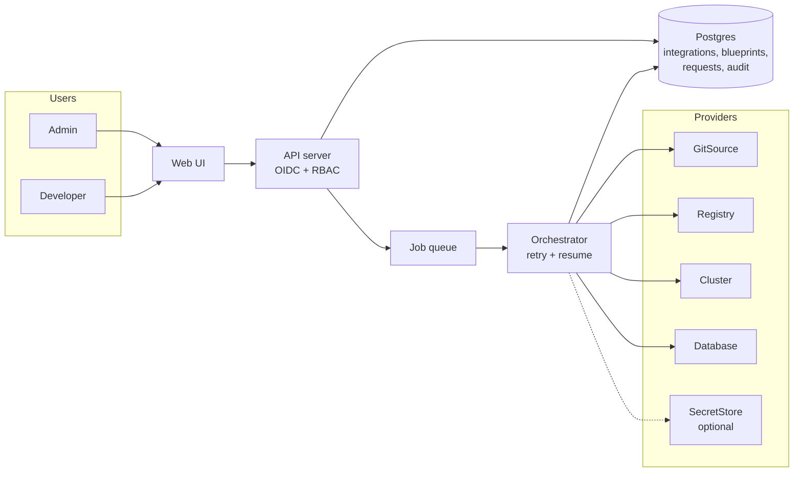
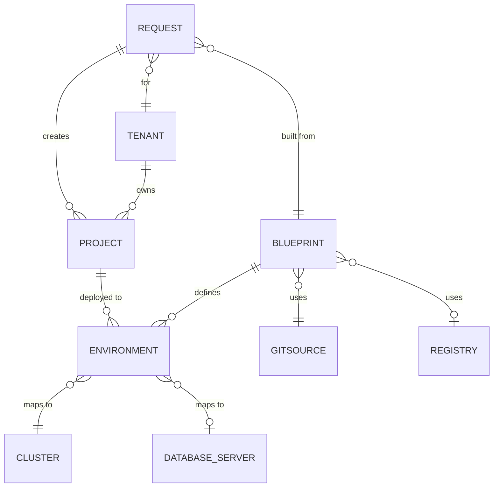
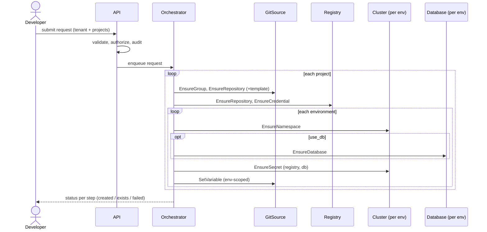
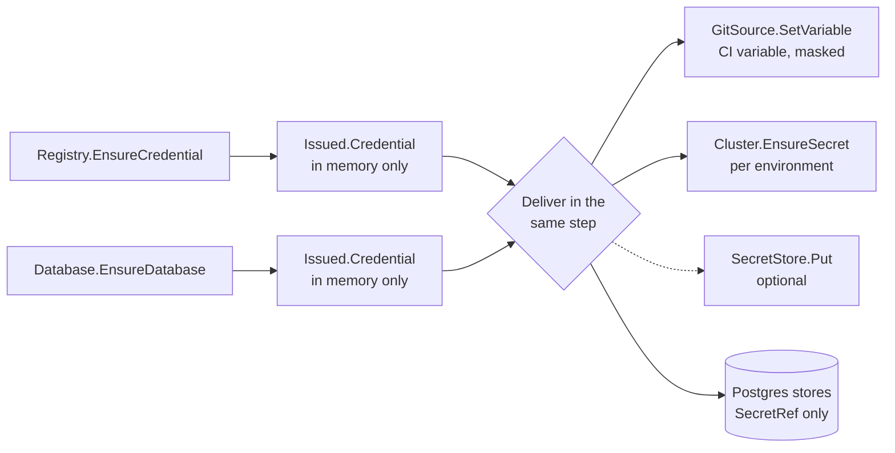

# Architecture

Diagrams are [Mermaid](https://mermaid.js.org/) so they render on GitHub and live in version control.

Plinth never assumes a particular product. "Git source", "registry", "cluster" and "database" are categories; GitHub, GitLab, Harbor, a cloud registry, any Kubernetes distribution, Postgres or MySQL are interchangeable **drivers** behind them.

## Components

## Domain model

An admin configures **integrations**, then combines them into a **blueprint** with one or more environments. A developer's **request** names a tenant (team) and its projects; the blueprint decides where everything goes.

Tables are in [`internal/store/migrations`](../internal/store/migrations/0001_init.sql).

## Request lifecycle

Every step is idempotent and keyed by a stable name (for example `cluster/shop/dev`). State is saved after each step, so a failed request resumes from the failed step.

## Credentials

Providers create credentials; a delivery step places them where they are consumed. A credential exists in memory only, is redacted when printed or logged, and is returned only when newly created or rotated, so a re-run never silently changes a password. Plinth's database keeps a `SecretRef`, never the value.

## Code map

| Package | Role |
|---|---|
| `internal/provider` | driver contracts and registry (`GitSource`, `Registry`, `Cluster`, `Database`, `SecretStore`) |
| `internal/provider/kubernetes` | Cluster driver for any Kubernetes distribution (see [drivers/kubernetes.md](drivers/kubernetes.md)) |
| `internal/provider/gitea` | GitSource driver for Gitea / Forgejo (see [drivers/gitea.md](drivers/gitea.md)) |
| `internal/provider/harbor` | Registry driver for Harbor (see [drivers/harbor.md](drivers/harbor.md)) |
| `internal/provider/postgres` | Database driver for PostgreSQL (see [drivers/postgres.md](drivers/postgres.md)) |
| `internal/onboarding` | turns a request + blueprint into steps and delivers credentials (see [onboarding.md](onboarding.md)) |
| `internal/orchestrator` | step runner with retry and resume |
| `internal/request` | request model and validation |
| `internal/naming` | resource naming rules (legacy-compatible defaults) |
| `internal/quota` | namespace resource tiers |
| `internal/api` | REST API, authorization, rate limiting (see [api.md](api.md)) |
| `internal/auth` | OIDC token verification and role mapping |
| `internal/store` | PostgreSQL persistence, migrations, request queue |
| `internal/worker` | claims queued requests and runs them |
| `internal/crypto` | envelope encryption of integration credentials |
| `internal/config` | environment configuration |
| `web` | React web interface, embedded into the binary (see [ui.md](ui.md)) |
| `deploy/helm/plinth` | Helm chart, with render tests and a cluster test (see [deploy.md](deploy.md)) |
| `internal/demo`, `cmd/plinth-demo` | simulated drivers and a stand-in identity provider for trying the interface |

## Planned

OIDC login, RBAC (admin/user), approval workflow, GitOps mode for cluster resources (commit manifests instead of applying), per-cluster pull agent so clusters need no inbound access, drift detection and deprovisioning.

## Roadmap

1. MVP: one git source, one cluster, one database driver; admin integrations UI; request form; status page.
2. Blueprints with several environments, a registry driver, optional central secret store, approvals.
3. More drivers, deprovision, drift detection, GitOps mode, plugin SDK.
