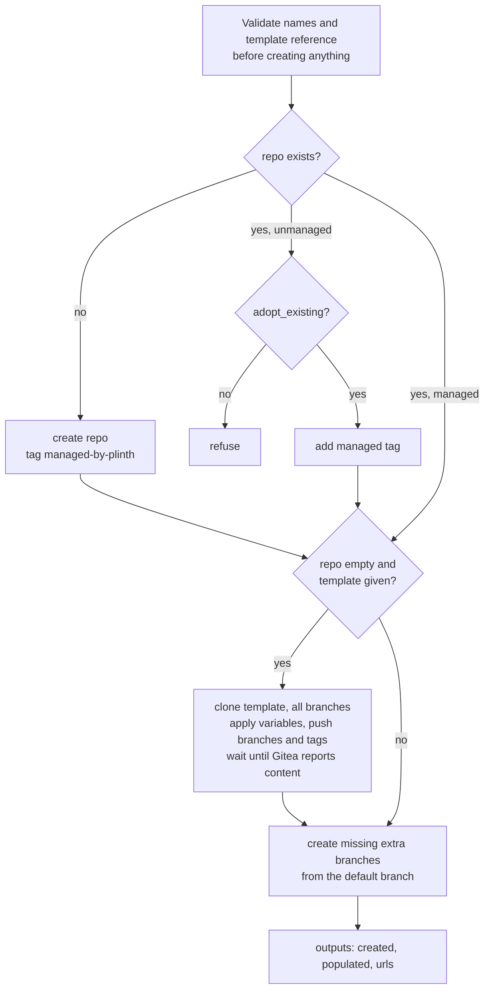

# Gitea git source driver

Driver `gitea` implements `provider.GitSource` for Gitea and compatible forks such as Forgejo. It ports `gitlab_onboard.sh` (group, repository, template, variables). GitHub and GitLab drivers will implement the same interface.

## Integration config

| Key | Required | Meaning |
|---|---|---|
| `base_url` | yes | instance URL; must be `https` |
| `token` | yes | access token able to create organizations and repositories and write Actions secrets/variables |
| `ca_cert` | no | PEM CA bundle for a private CA |
| `allow_http` | no | `"true"` permits `http://` (local testing only) |
| `adopt_existing` | no | `"true"` takes over repositories created before Plinth |

The `git` binary must be on the `PATH` (the Docker image includes it).

## Mapping of the generic concepts

| Plinth | Gitea | Note |
|---|---|---|
| `GroupSpec` (tenant) | organization | Gitea has no nested groups, so `GroupSpec.Parent` is ignored |
| `RepoSpec` | repository in that organization | |
| `VariableSpec` | Actions variable, or Actions secret when `Masked`/`File` | Gitea has no environment scoping and no file variables; `Scope` is ignored (per-env keys such as `DB_HOST_DEV` already differ) and `File` values are stored as-is |

## What `EnsureRepository` does

Population is keyed on "the repository is empty", not on "was just created". A crash between creating and populating is therefore repaired by the next attempt, and a repository that already has content is never modified.

## Safety rules

- Repositories Plinth creates carry the topic `managed-by-plinth`. Variables and secrets are only written to, and repositories only deleted from, managed repositories.
- The instance token is sent to the Gitea host only, in an HTTP header supplied through the environment, never in a URL or process arguments. A template hosted elsewhere is cloned anonymously.
- Template references are `owner/name` on the same instance or an `http(s)` URL without credentials; `file://`, `ssh://` and `ext::` are refused, and git's allowed protocols are restricted to http(s).
- Template variables are replaced literally (no regular expressions or shell). Binary files, symlinks and files over 1 MiB are skipped. Only tracked files are touched, never `.git`.
- Errors and logs never contain the token or variable values.

## Differences from the legacy script

| Legacy | Now |
|---|---|
| Admin token embedded in the push URL (`oauth2:TOKEN@`) | Token in an environment-supplied header |
| `sed` over `find . -type f`, which also walks `.git/` | Only tracked text files, literal replacement |
| Substitution edited the working tree but **never committed**, so (reading the script) it had no effect on what was pushed | Substitution is committed on every branch |
| The template contains no `PROJECT_NAME`; it uses `$CI_PROJECT_NAME` resolved by the CI system | Variables are optional and generic, so a template without placeholders works unchanged |
| "Exists" meant leave alone, even if a previous run died half-way | Empty managed repositories are completed on retry |
| Only the `main` branch exists, yet the pipeline expects `develop` and `staging` | `RepoSpec.ExtraBranches` creates them from the default branch |
| Repo creation, template push and CI variables in one run-once block | Separate idempotent calls |

## Known limits

- The current golden template ships a `.gitlab-ci.yml`, so it only works on GitLab CI. Gitea (and GitHub) need a template with their own workflow files; the driver only copies what the template contains.
- No environment-scoped variables and no file-type variables (see mapping).
- No repository membership or team management yet. Access to workloads is granted in the cluster through the OIDC group binding, as before.

## Tests

`make itest-git` starts a disposable `gitea/gitea` container (override with `PLINTH_TEST_GITEA_VERSIONS`), creates an admin and token, builds a template with two branches, a tag and a binary file, and verifies: organization created once, population of all branches and tags with substitution (binary untouched), extra branches, re-runs that never touch developer work, recovery of a half-created repository, refusal and adoption of pre-existing repositories, variable and secret upserts, no token or secret in errors, and idempotent delete. The container is removed afterwards.

It found a real bug on its first run: Gitea updates its "empty" flag asynchronously after a push, so creating extra branches immediately failed. The driver now waits for the flag.
