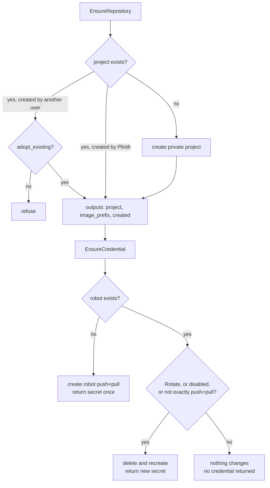

# Harbor registry driver

Driver `harbor` implements `provider.Registry` for [Harbor](https://goharbor.io). It replaces the registry part of `registry_onboard.sh` and `secrets_onboard.sh`. Other registries (a cloud registry, GitLab) will implement the same interface.

## Integration config

| Key | Required | Meaning |
|---|---|---|
| `base_url` | yes | Harbor URL; must be `https` |
| `username`, `password` | yes | the identity Plinth acts as. Use a **dedicated account** (see ownership below) with permission to create projects and robot accounts |
| `ca_cert` | no | PEM CA bundle for a private CA |
| `allow_http` | no | `"true"` permits `http://` (local testing only) |
| `robot_name` | no | name of the per-project robot, default `ci` |
| `robot_ttl_days` | no | robot lifetime in days; default `0` = never expires |
| `adopt_existing` | no | `"true"` takes over projects created by someone else |

## Mapping

| Plinth | Harbor |
|---|---|
| `RegistrySpec.Repo` | a **private project**; images are pushed as `<host>/<project>/<image>` |
| `EnsureCredential` | a project-level **robot account** limited to `push` + `pull` on that project |
| `Issued.Credential` | `server`, `username` (`robot$<project>+ci`), `password` |

Registry templates and pipelines should therefore reference `$REGISTRY/<project>/<image>`. The output `image_prefix` gives `<host>/<project>`.

## Safety rules

- Projects are always **private**.
- A robot can only push and pull in its own project. A robot with any other permission (for example `delete`), or a disabled one, is **replaced** on the next run, so manual over-privileging does not persist.
- The secret exists only in the returned `Credential` (redacted when printed) and only when newly issued. A re-run never changes it.
- Harbor projects carry no free-form metadata, so "managed by Plinth" means *created by the identity Plinth authenticates as*. Projects created by anyone else are refused (for `EnsureRepository`, `EnsureCredential` and `DeleteRepository`) unless `adopt_existing` is set.
- `DeleteRepository` deletes only managed projects, and Harbor itself refuses while the project still contains images. That is reported as an error and never forced.
- Names are validated against Harbor's project-name rules before any request. Errors never contain the password or a robot secret.

## Differences from the legacy script (ACR)

| Legacy | Now |
|---|---|
| Created an ACR repository by pulling and pushing a dummy image, which needs Docker-in-Docker | Creating a project needs no image |
| Deleted and recreated the token whenever either the token or its CI variable was missing | Credential created once; recreated only on `Rotate` or when invalid/over-privileged |
| Credentials also stored as masked CI variables by the same script | Delivery is a separate step (`GitSource.SetVariable`, `Cluster.EnsureSecret`) |

## Known limits

- If a credential is issued and the process dies before it is delivered, the secret is lost (Plinth never stores it). The orchestrator step must deliver in the same step and call `EnsureCredential` with `Rotate: true` on a retry after a failed delivery. That wiring is not written yet.
- Robots do not expire by default. Set `robot_ttl_days` if you also schedule rotation.
- Only Harbor is implemented; ACR and GitLab registry drivers are not.

## Tests

`make itest-registry` runs against a **disposable Harbor** started and removed by `scripts/harbor.sh` (Docker required), or against an existing Harbor if `PLINTH_TEST_HARBOR_URL`, `PLINTH_TEST_HARBOR_USER` and `PLINTH_TEST_HARBOR_PASSWORD` are set. With images already pulled it takes about 1.5 minutes; the first run also downloads about 2.5 GB.

It verifies: private project creation and re-use, a robot limited to push and pull on its own project (no `delete`, nothing on another tenant's project), wrong secrets granting nothing, no secret change on re-run, rotation invalidating the old secret, replacement of an over-privileged robot, refusal and adoption of another user's project, hostile names, no secret leakage, and idempotent delete. Permissions are checked the way a Docker client experiences them: by asking Harbor's token service what a robot may do.

Things learned while testing:

- Harbor's token endpoint answers **HTTP 200 with an empty permission list** for wrong credentials. Judge access by the granted actions, never by the status code. (An earlier version of the test got this wrong and falsely reported that rotation had failed.)
- Harbor images are published for **amd64 only**. On Apple Silicon they run under QEMU emulation, where Harbor's cache (Valkey) crashes with a segmentation fault. `scripts/harbor.sh` therefore swaps only that one service for a native multi-arch Valkey image on arm hosts. It is a plain cache, so the API behaviour under test is unchanged. On x86 hosts nothing is swapped.
