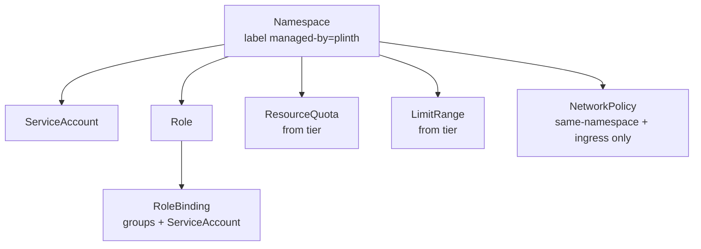

# Kubernetes cluster driver

Driver `kubernetes` implements `provider.Cluster` for any conformant Kubernetes distribution (managed cloud, on-prem, k3s, kind...). It ports `k8s_onboard.sh` from the legacy scripts.

## Integration config

| Key | Required | Meaning |
|---|---|---|
| `server` | yes | API server URL |
| `ca_cert` | yes | PEM CA bundle. TLS verification cannot be disabled. |
| `token` | yes | Bearer token of a dedicated ServiceAccount (not cluster-admin, see below) |
| `adopt_existing` | no | `"true"` lets Plinth take over namespaces that already exist without its label (use once when migrating legacy tenants) |

Per environment (blueprint): `access_prefix` (OIDC group prefix on that cluster) and `ingress_ns` (where the ingress controller runs).

## What `EnsureNamespace` applies

All objects use server-side apply (field manager `plinth`), so re-running converges to the desired state and reports `created=false`.

## Differences from the legacy manifests

| Legacy | Now | Why |
|---|---|---|
| RoleBinding ServiceAccount subject had no `namespace` | set | required by the API |
| `roleRef` had no `apiGroup` | set | required by the API |
| Role had no PVC access | adds `persistentvolumeclaims`, `statefulsets`, pod logs, events and replicasets (read) | the app template ships a PVC |
| Role used the removed `extensions` API group | dropped | removed from Kubernetes |
| Tenants could not touch isolation (not granted) | still true, tested | tenants must not weaken NetworkPolicy, quota or RBAC |
| Role gives full access to Secrets | **unchanged** | the app template deploys a Secret; revisit when secrets move to an external store |

## Safety rules

- Reserved namespaces (`default`, `kube-*`, the ingress namespace) are refused. A request for tenant `kube` + project `system` cannot touch `kube-system`.
- An existing namespace without Plinth's label is refused unless `adopt_existing` is set.
- `EnsureSecret` only writes into Plinth-managed namespaces, and errors never contain secret data.
- `DeleteNamespace` only deletes Plinth-managed namespaces.

## Permissions for the ServiceAccount Plinth uses

Apply [`deploy/kubernetes/plinth-rbac.yaml`](../../deploy/kubernetes/plinth-rbac.yaml) once per cluster, then create a short-lived token for the `plinth` ServiceAccount. The ClusterRole is the minimum the integration test proved sufficient:

- namespaces: get, list, create, patch, delete
- serviceaccounts, resourcequotas, limitranges, roles, rolebindings, networkpolicies: get, create, patch
- secrets: create, patch (**no read**: Plinth writes credentials but never reads them back)
- roles: `escalate` and `bind`, so it can create the tenant Role without holding every permission itself

This is still a **highly privileged identity**: `escalate`/`bind` let it grant namespace permissions anywhere. Treat its token like a cluster-admin credential and keep it short-lived. A GitOps mode (commit manifests, let the cluster pull them) would remove this credential entirely.

## Tests

| Level | Command | What it proves |
|---|---|---|
| Unit | `make test` | manifest content, guards, apply and convergence against a fake API server |
| Integration | `make itest` | everything below, on a real cluster (kind if installed, else k3d), authenticating as the least-privilege ServiceAccount |

The integration test checks: the RBAC manifest is sufficient (no escalation errors), first run creates and second run converges, quota values land correctly, tenant permissions via SubjectAccessReview (can deploy, PVC and Secrets; cannot change NetworkPolicy, quota or RoleBindings; cannot reach `kube-system`), the LimitRange really rejects an oversized container, secrets are written but not readable by Plinth, reserved and unmanaged namespaces are refused, and delete works.

It only runs when `PLINTH_TEST_CONTEXT` names a context containing `plinth-test`, so it cannot touch a real environment by accident.

## Not covered yet

- **NetworkPolicy enforcement.** The test confirms the policy object exists; whether traffic is actually blocked depends on the cluster's CNI (kindnet and the k3s default behave differently).
- **ResourceQuota rejection** of the Nth pod and the OIDC group claims of a real identity provider.
- **Other distributions** (managed cloud clusters) and older Kubernetes versions.
