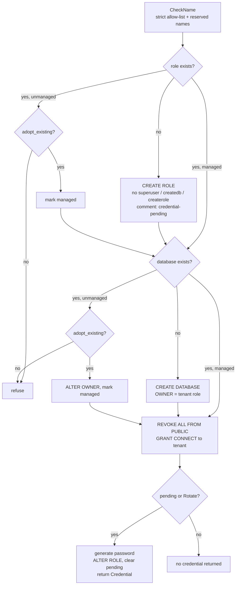

# PostgreSQL database driver

Driver `postgres` implements `provider.Database`. It ports `database_onboard.sh` (`pgsql_onboard`) and fixes its security and idempotency problems.

## Integration config

| Key | Required | Meaning |
|---|---|---|
| `host` | yes | server hostname |
| `port` | no | default 5432 |
| `admin_user` | yes | role with `CREATEDB` and `CREATEROLE` (or superuser / the managed-service equivalent) |
| `admin_password` | yes | stored encrypted, never logged |
| `admin_database` | no | maintenance database, default `postgres` |
| `sslmode` | no | `verify-full` (default), `require` (encrypts, does not verify the server), `disable` |
| `ca_cert` | no | PEM CA bundle for `verify-full` |
| `adopt_existing` | no | `"true"` takes over roles and databases created before Plinth (use once when migrating legacy tenants) |

PostgreSQL 13 or newer is required (`DROP DATABASE ... WITH (FORCE)`). On PostgreSQL 16+ a non-superuser admin must also be allowed to `SET ROLE` to the tenant roles it creates; a superuser or managed-service superuser role always works.

## What `EnsureDatabase` does

## Differences from the legacy script

| Legacy | Now |
|---|---|
| New random password on **every run**, applied with `ALTER USER` | Generated only when the role is first created, or on explicit `Rotate`. A re-run returns no credential and changes nothing. |
| SQL built by string interpolation (`'$db_pass'`, `"$db_name"`) | Identifiers and literals quoted by the server with `format(%I, %L)`; names validated against an allow-list first |
| Database owned by the admin, `GRANT ALL ON DATABASE` | The tenant role **owns** its database. This is what lets it create tables in `public` on PostgreSQL 15+, where ordinary roles no longer can. |
| Other roles could connect (default `PUBLIC` privilege) | `REVOKE ALL ON DATABASE ... FROM PUBLIC`; only the owner connects |
| Credentials written to a plaintext `db_credentials.json` artifact | Returned in memory as a redacted `Credential`; delivery is a separate step |
| Admin password in `PGPASSWORD`, client installed at runtime | Native driver (pgx), TLS verified by default, `PG*` environment variables ignored |
| Crash between creating the role and setting its password lost the password | A `credential-pending` marker on the role lets a retry finish and still return the credential |

## Safety rules

- Names must match `^[a-z0-9][a-z0-9_-]{0,62}$` and cannot be `postgres`, `public`, `template0/1`, `pg_*` or the admin role. Dashes are allowed (the legacy naming produces them) and are safe because every use is quoted.
- Tenant roles are created `NOSUPERUSER NOCREATEDB NOCREATEROLE NOREPLICATION NOBYPASSRLS`. Adopting a role that already has any of those privileges is refused.
- Plinth only alters or drops roles and databases carrying its comment marker (`managed-by:plinth`). `DeleteDatabase` refuses anything else.
- Errors never contain passwords or SQL statements.

## Known limits

- **Metadata visibility.** PostgreSQL lets every role connect to the shared maintenance database (`postgres`) and read the shared catalogs, so a tenant can list database and role *names* of other tenants (not their data: connecting to another tenant's database is revoked). Plinth does not change the maintenance database because other users of the server depend on it. Use a dedicated server per trust boundary if names are sensitive.

If a credential is issued and the process dies **before it is delivered**, the password is lost (Plinth never stores it). The orchestrator step must therefore deliver in the same step and, when a retry follows a failed delivery, call `EnsureDatabase` with `Rotate: true`. That wiring belongs to the step implementation and is not written yet.

## Tests

`make itest-db` starts disposable `postgres:17`, `16` and `15` containers (override with `PLINTH_TEST_PG_VERSIONS`), runs the full suite on each in parallel and removes them. It verifies: a working first credential, creating tables in `public`, no password change on re-run, rotation, tenant isolation (tenant B cannot connect to A's database), minimal role privileges, hostile names, adoption of a legacy-style role and database, recovery of a half-created role, no password leakage in errors, and idempotent delete.
