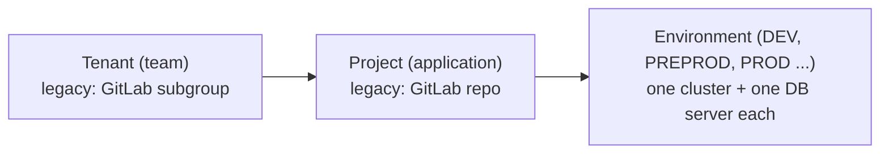

# Legacy mapping: DevPort scripts to Plinth

Source: `../devport-automation`

- `legacy_scripts/*.sh` + `validate_onboarding_json.py`: the **complete** implementation (~1,500 lines). Treat as the spec.
- `src/` (Node, ~560 lines): an **incomplete** port. Registry and secrets are ACR-only, MongoDB is a stub, DB credentials are never delivered, and the default task runs only GitLab + k8s. Do not use it as a spec.
- `legacy_scripts/gitlab_k8s_vars.sh` is an older combined version of `registry_onboard.sh` + `secrets_onboard.sh`. It is superseded; ignore it.

All paths below are relative to `devport-automation/`.

## 1. Domain model the scripts imply



The legacy setup used GitLab, Azure Container Registry, Kubernetes and Postgres/MySQL. Those are **drivers**, not part of the model; Plinth's code and interfaces stay product-neutral.

- One pipeline run onboards **one tenant and a list of projects** (`PROJECTS_JSON`), across all environments.
- `K8S_ENVS` and `DB_ENVS` are platform-wide lists, not per request. Plinth should move them into the blueprint (each environment maps to a cluster integration and a database integration).
- The Plinth schema currently has `requests.project_name` (one project, no tenant or environments). **Change it**: add `tenant` (team) and make the project and environment lists explicit.

### Naming rules (must be preserved for existing tenants)

| Thing | Name | Source |
|---|---|---|
| normalized name | lowercase, strip whitespace, remove everything not `[a-z0-9_-]` | `helper.sh:normalize_name` |
| Git repo path | `{PARENT_GROUP}/{TENANT_SUBGROUP}/{project}` | `gitlab_onboard.sh:52` |
| k8s namespace | `{tenant}-{project}` (same name in every cluster) | `k8s_onboard.sh:175` |
| ServiceAccount / Role / RoleBinding / ResourceQuota / LimitRange / NetworkPolicy | `{ns}-sa` / `-role` / `-role-binding` / `-quota` / `-limits` / `-isolation` (suffixes configurable) | `k8s_onboard.sh:7-14` |
| Registry repo / scope map / token | `{tenant}-{project}` / `{repo}-scope-map` / `{repo}-token` | `registry_onboard.sh:33` |
| DB name = DB user | `normalize({tenant}_{project}_{ENV})` | `database_onboard.sh:82` |
| Registry pull secret in ns | `regcred` | `K8S_REGISTRY_SECRET_NAME` |
| DB secret in ns | `db-credentials` (keys `db-host`, `db-name`, `db-user`, `db-password`) | `secrets_onboard.sh:212` |

Plinth keeps these as **default naming templates in the blueprint**, so new installs can change them.

## 2. Request schema (from `validate_onboarding_json.py`)

```jsonc
{
  "tenant": "team-a",                       // TENANT_SUBGROUP, normalized
  "projects": [{
    "name": "sample-app",                   // required, must be non-empty after normalization
    "description": "…",                     // optional
    "public": false,                        // repo visibility, default private
    "host_url": "app.example.com",          // protocol stripped; becomes HOST var
    "application_port": 8080,               // becomes PORT var
    "quota": "bronze",                      // bronze|silver|gold, default bronze
    "use_db": true,                         // legacy sends the strings "true"/"false"; accept both
    "db_type": "postgresql"                 // mysql|postgresql|mongodb (mongodb is a stub)
  }]
}
```

The quota tiers (`scripts/quota.json`) become seed data for a `quota_tiers` table or blueprint field: pods, requests/limits CPU+memory, and a LimitRange (min/max/default/defaultRequest) per tier. The legacy validator never checks `host_url` or `application_port`, so Plinth should (hostname syntax, port range, uniqueness of host across projects).

## 3. Step-by-step mapping

Order is by dependency. Each Plinth step is idempotent per (project, environment) where noted.

### 3.1 `GitSource` (gitlab_onboard.sh)

| # | Legacy action | Plinth step / method |
|---|---|---|
| 1 | Look up parent group by name; fail if absent | validate integration config (`Validate`) |
| 2 | Create tenant subgroup under parent if missing | `EnsureGroup(tenant)` **(new method)** |
| 3 | Per project: create blank repo (no README) in the subgroup, visibility from `public` | `EnsureRepository` |
| 4 | Only if newly created: clone golden template, `sed` `PROJECT_NAME` to the project name in all files, push all branches and tags | `EnsureRepository` with `TemplateRepo`; replace via a Go templating pass over tracked files, not `sed` |
| 5 | Only if newly created: set CI variables `HOST` and `PORT` | `SetVariable` **(new method)** |

Notes:
- Existing repos are left untouched ("Exists"). Keep that: never overwrite code.
- Template access uses `CI_JOB_TOKEN` and the repo is pushed using the admin PAT embedded in the remote URL. In Plinth, use a GitHub App installation token or scoped deploy token, and never put tokens in URLs or logs.
- `find . -type f -name '*'` also walks `.git/`. Plinth should substitute only tracked files.
- The README claims "membership management", but **no script adds members**. Access is granted in the cluster through a group RoleBinding (see 3.3). Decide whether Plinth also manages repo membership.

### 3.2 `Registry` (registry_onboard.sh, first half of secrets_onboard.sh)

| # | Legacy action | Plinth step / method |
|---|---|---|
| 1 | GitLab CR mode: enable `container_registry_enabled` on the project | `Registry.EnsureProject` (gitlab driver) |
| 2 | ACR mode (`USE_AZURE_ACR`, default true): create repo `{tenant}-{project}` by pulling and pushing a dummy image (`ACR_INIT_IMAGE`, default `mcr.microsoft.com/hello-world`) | `EnsureProject` (acr driver) |
| 3 | ACR: create scope map `{repo}-scope-map` with `content/read` + `content/write` on that repo | same |
| 4 | Create credential: GitLab deploy token (`read_registry`+`write_registry`) or ACR token bound to the scope map | `Registry.EnsureCredential` **(split out of `EnsureProject`)** |
| 5 | Build a docker config JSON (`{"auths":{registry:{auth:base64(user:token)}}}`) | deliver step |

Notes:
- The dummy-image push needs docker-in-docker in the runner. ACR scope maps can probably target a repository that does not exist yet, which would remove that step. Verify this before dropping it.
- The legacy "idempotency" **deletes and recreates** the token and variable when either is missing. Plinth should create the credential once and only rotate on explicit request.
- Admin login to Azure uses a service principal (`SP_CLIENT_ID/SECRET`, `TENANT_ID`, `SUBSCRIPTION_ID`; the docs and Node code call them `AZ_SP_*`). In Plinth these are fields of the `registry/acr` integration.

### 3.3 `Cluster` (k8s_onboard.sh)

Per project, per environment (cluster). Resources are created with `kubectl apply`, which is already idempotent.

| # | Resource | Detail |
|---|---|---|
| 1 | Namespace `{tenant}-{project}` | |
| 2 | ServiceAccount `{ns}-sa` | |
| 3 | Role `{ns}-role` | get/list/watch/create/update/patch/delete on deployments, services, ingresses, configmaps, **secrets**, pods, serviceaccounts (core/apps/extensions/networking.k8s.io) and jobs, cronjobs (batch) |
| 4 | RoleBinding `{ns}-role-binding` | subjects: **group** `gitlab:{PARENT_GROUP}/{TENANT_SUBGROUP}` and the SA |
| 5 | ResourceQuota `{ns}-quota` | from the tier: pods, requests.cpu/memory, limits.cpu/memory |
| 6 | LimitRange `{ns}-limits` | Container min/max/default/defaultRequest from the tier |
| 7 | NetworkPolicy `{ns}-isolation` | Ingress only: allow same-namespace pods and the ingress controller namespace (`K8S_INGRESS_NS`, default `kube-system`, i.e. Traefik on k3d) |

Cluster auth in the scripts: client cert + key + CA + API server URL per env (`K8S_CA_CERT_{ENV}`, `K8S_API_SERVER_{ENV}`, `K8S_CLIENT_CERT_{ENV}`, `K8S_CLIENT_KEY_{ENV}`). The docs list `AKS_CA/SERVER/TOKEN` instead, which does not match the code. In Plinth these are the fields of the `cluster/kubernetes` integration (prefer a ServiceAccount token over client certs).

Things to decide or fix when porting (I have not run these manifests):
- RoleBinding SA subject has no `namespace`, and `roleRef` has no `apiGroup`. The Kubernetes API normally requires both. Check that the legacy apply really succeeds.
- The Role has **no `persistentvolumeclaims`**, but `devport-app-template/k8s/` ships a `pvc.yaml`. Also no `replicasets`/`statefulsets`, and `extensions` is a removed API group.
- Role grants full CRUD on **secrets** to the whole group, including the DB and registry credentials. Consider read-only for humans and full only for the CI identity.
- NetworkPolicy has no egress rules and no default-deny. The group binding assumes OIDC groups prefixed `gitlab:` (see `devport-kb/docs/platform-admin-guide/oidc-setup.md`), so make the group prefix a cluster-integration setting.

### 3.4 `Database` (database_onboard.sh)

Per project, per environment in `DB_ENVS`, only if `use_db == "true"`.

| Driver | Legacy behaviour |
|---|---|
| `postgres` | Create role if missing, else `ALTER` password. Create DB if missing. `GRANT ALL PRIVILEGES ON DATABASE`. |
| `mysql` | `CREATE DATABASE IF NOT EXISTS`, create user `@'%'`, set password, `GRANT ALL ON db.*`, flush. Uses `--skip-ssl`. |
| `mongodb` | Placeholder, does nothing but print. Out of scope for v1. |

Admin credentials per env: `{PGSQL|MYSQL}_DB_HOST_{ENV}`, `_DB_ADMIN_{ENV}`, `_DB_ADMINPASS_{ENV}`. They are fields of the `database/postgres` and `database/mysql` integrations.

Things to fix when porting:
- **Password is regenerated on every run** (`openssl rand -hex 16`) and applied with `ALTER USER`, so a re-run silently rotates it. Plinth should generate once on create and rotate only on request.
- Passwords are interpolated into SQL strings and the credentials land in **plaintext** `db_credentials.json` as a pipeline artifact. Use parameterised/quoted identifiers and write straight to the secret destination.
- MySQL connects with `--skip-ssl`; make TLS the default.
- `GRANT ALL PRIVILEGES ON DATABASE` in Postgres does not grant schema `public` rights on PG 15+. Verify what the apps actually need and grant the least.
- Install of clients at runtime (`apk add`) disappears when the driver speaks the protocol natively (`pgx`, `go-sql-driver/mysql`).

### 3.5 Secret delivery (secrets_onboard.sh)

This is where credentials meet their consumers. There is **no vault**: GitLab CI variables and Kubernetes Secrets are the stores.

| Secret | Destinations |
|---|---|
| Registry credential | GitLab CI vars `REGISTRY_USER`, `REGISTRY_PASSWORD` (masked); `DOCKER_AUTH` (masked file var, base64 docker config); and in every env cluster a `kubernetes.io/dockerconfigjson` secret `regcred` in the project namespace |
| DB credential | GitLab CI vars `DB_HOST_{ENV}`, `DB_NAME_{ENV}`, `DB_USER_{ENV}`, `DB_PASS_{ENV}` (password masked, scoped by `environment_scope`); and a `db-credentials` Secret in the project namespace of that env |
| App settings | `HOST`, `PORT` CI vars (set in 3.1) |

Known bugs in this stage:
- The k8s registry secret is only updated when the token was **just created**. If the GitLab variable exists but the cluster secret was deleted, nothing repairs it.
- On a recreate, `DOCKER_AUTH` is deleted but `REGISTRY_USER` and `REGISTRY_PASSWORD` are not, so the next `POST` for them fails with `--fail` (variable exists).
- The Node port never delivers DB credentials (the code is commented out).

## 4. What this means for the Plinth design

Status: items 1, 2 and 4 are implemented in code; 3 is still open.

1. **Credential creation is split from delivery** (done). Providers return an `Issued` value whose `Credential` is held in memory, redacted when printed, and set only when newly created or rotated (this fixes the "password changes on every run" behaviour). Delivery uses `GitSource.SetVariable` and `Cluster.EnsureSecret`; `SecretStore` is an optional central backend. Open question: a crash between creating and delivering a credential. Plan: create and deliver in the same step, and let a retry recreate or rotate.
2. **Interfaces extended** (done): `GitSource.EnsureGroup`, `GitSource.SetVariable`, `Registry.EnsureCredential`, `Cluster.EnsureSecret`. A CI variable maps to the git host's equivalent (for example repository secrets/variables with environment scoping for per-env DB values).
3. **Cluster resources are data, not code** (open). The Role rules, NetworkPolicy and LimitRange become templates in the blueprint, with the quota tiers as inputs. This also makes a GitOps mode (commit manifests to a config repo) straightforward.
4. **Request model** (done in `internal/request`, schema in `0001_init.sql`): `tenant` + `projects[]`, environments from the blueprint, per-step results in the request state. Validation rules were ported with tests; deliberate tightenings: names must be DNS labels (legacy allowed `_`, which Kubernetes rejects), duplicate projects are rejected, and host and port are checked.
5. **Statuses** match the legacy summary tables: created / exists / skipped / unsupported / failed per project and environment. Store them as step results.
6. **Variable inventory to migrate.** Everything in `VARIABLES_DOCUMENTATION.md` (and the real names used in the code, which differ in places) becomes integration config, encrypted at rest. See the comparison:

| Concern | Used by scripts | Documented | Plinth home |
|---|---|---|---|
| Azure SP | `SP_CLIENT_ID`, `SP_CLIENT_SECRET`, `TENANT_ID`, `SUBSCRIPTION_ID` (shell); `AZ_SP_*` (Node) | `AZ_SP_*`, `AZ_TENANT_ID`, `AZ_SUBSCRIPTION_ID` | `registry/acr` integration |
| Cluster creds | `K8S_{CA_CERT,API_SERVER,CLIENT_CERT,CLIENT_KEY}_{ENV}` | `AKS_{CA,SERVER,TOKEN}_{ENV}` | `cluster/kubernetes` integration |
| DB admin | `{MYSQL,PGSQL}_DB_{HOST,ADMIN,ADMINPASS}_{ENV}` | same | `database/*` integration |
| GitLab | `GITLAB_API_TOKEN`, `GITLAB_BASE_URL`, `PARENT_GROUP` (default `tenants`), `TEMPLATE_REPO_URL` | same | `gitsource/gitlab` integration |
| Behaviour | `K8S_ENVS`, `DB_ENVS`, `USE_AZURE_ACR`, `K8S_QUOTA_FILE`, `K8S_*_SUFFIX`, `K8S_INGRESS_NS`, `GITLAB_DOCKER_AUTH_VAR_NAME`, `K8S_REGISTRY_SECRET_NAME`, `ACR_INIT_IMAGE` | partly | blueprint |

## 5. Suggested port order

1. Request validation and naming (pure functions, easy to test against the legacy behaviour).
2. `Cluster` (kubernetes driver): highest value and fully idempotent.
3. `Database` (postgres), with the generate-once password behaviour.
4. `GitSource` (the target your users choose; start with GitHub, keep GitLab for parity with existing tenants).
5. `Registry` (start with the one you use today) and the delivery sinks.
6. Delete the matching legacy script once its Plinth step passes the same cases.
