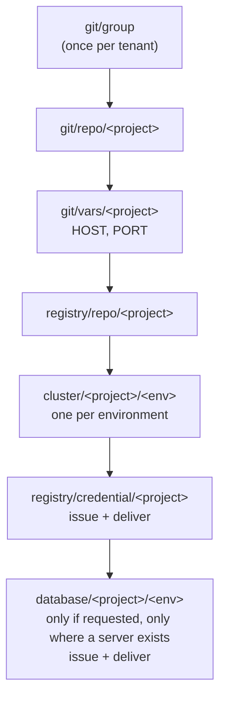
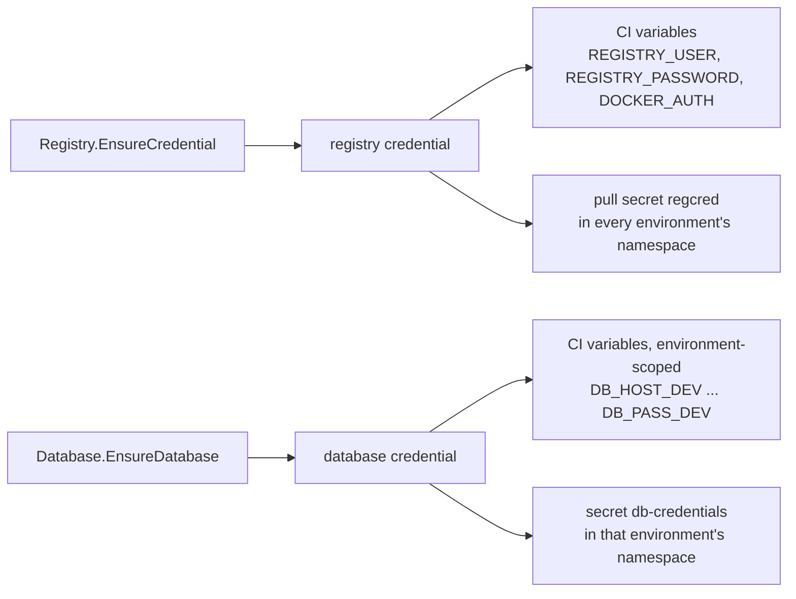
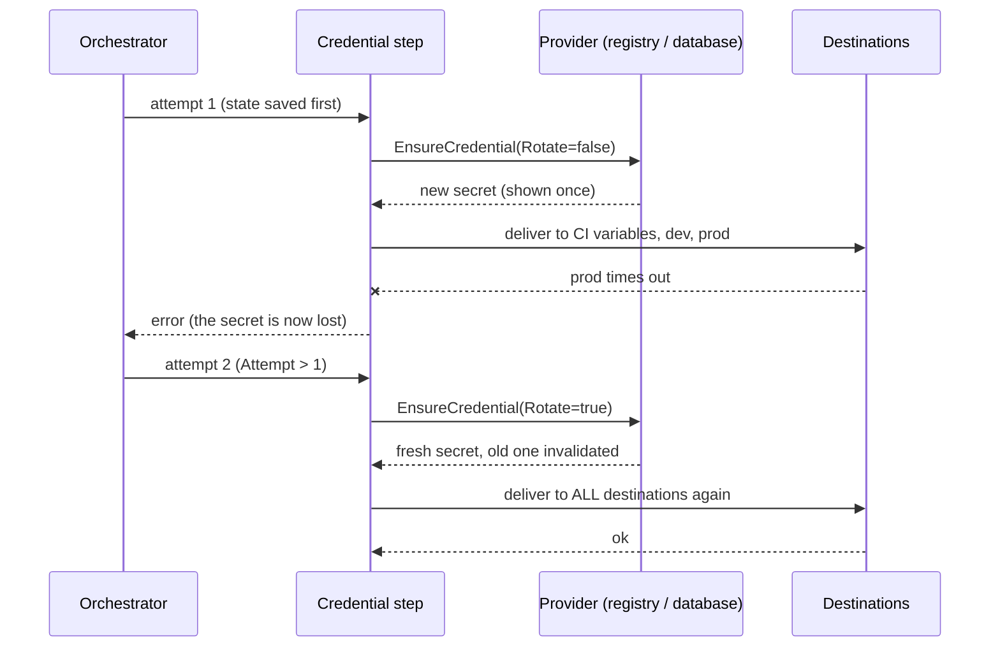

# Onboarding: from request to running steps

`internal/onboarding` turns a validated request and a **blueprint** into ordered, idempotent steps, runs them through the orchestrator, and delivers the credentials the steps create. Nothing in it names a product: it only talks to the generic provider interfaces.

## Blueprint

A blueprint is the resolved set of systems a request is built on:

| Field | Meaning |
|---|---|
| `Git`, `GitParent`, `TemplateRepo`, `TemplateVars`, `ExtraBranches` | the git source, where tenants live, the golden template and branches to create |
| `Registry` | optional container registry |
| `Envs[]` | environments (e.g. `dev`, `prod`), each with a `Cluster`, an optional `Database` server, the cluster's OIDC group prefix and its ingress namespace |
| `Tiers` | namespace quota tiers |

## Steps

Steps run in dependency order, per project. Names are stable, which is what makes resume work.

The credential steps come after the cluster steps because they deliver into the namespaces.

## Credential delivery

A provider hands out a secret at most once. The step that receives it delivers it to **every** destination before finishing, and never puts it in the request state.

### What happens when delivery fails

The rule is simple: any attempt after the first rotates. State is saved **before** each attempt, so even a crash mid-delivery leaves a record, and the resumed run rotates instead of assuming the credential still exists. An attempt that never reached the provider rotates needlessly, which is harmless.

## What is recorded

`State.Steps` holds per-step status, error text and lifetime attempt count (for a status page). `State.Outputs` holds non-secret facts keyed `<step>.<key>` (for example `cluster/shop/dev.namespace` or `registry/credential/shop.issued`). Secrets are never in the state; a test scans every saved snapshot for them.

## Re-running a request

Submitting the same request again changes nothing: every provider call is idempotent, existing credentials are not re-issued (`...issued = false`), and developer work in repositories is never touched.

## Tests

| Level | Command | Covers |
|---|---|---|
| Unit, fake providers | `make test` | step order, delivery to every destination, no secrets in state, rotation after a failed delivery, resume, validation against the blueprint |
| End to end, real drivers | `make e2e` | the same request through two Kubernetes clusters, PostgreSQL, Gitea and Harbor; see below |

`make e2e` (`scripts/e2e.sh`) starts a disposable stack, then runs `TestEndToEnd`, which onboards a tenant with two projects (one with a database), injects a delivery failure into one cluster, and verifies in the real systems: populated private repositories with extra branches and the template placeholder replaced, variables and secrets, namespaces with the right quota tier in both clusters, a registry credential limited to its own project, the same credential in every environment after the retry, a working and isolated database login, no secret in the persisted state, and that submitting the request again is a no-op. Everything is deleted afterwards.
