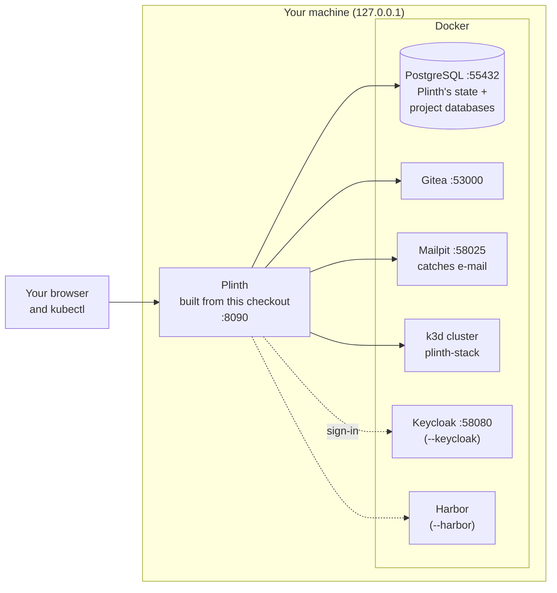

# A complete local stack

`make stack` starts Plinth and the real systems it manages on your machine and **keeps them running**, with the integrations and two blueprints already set up, so you can try everything by hand: request a project, watch a repository, a namespace and a database appear, read the e-mail Plinth sends, invite a colleague, approve a request.

It is for local testing: everything listens on `127.0.0.1` over plain http, with generated throwaway passwords.



## Which one do I want?

| | Systems | Kept running | Checks results |
|---|---|---|---|
| `make demo` | simulated | yes | no. For trying the interface in seconds |
| **`make stack`** | **real** | **yes** | **you do. For exploring and for debugging against real systems** |
| `make e2e`, `make helm-e2e` | real | no, deleted at the end | yes, automatically |

## You need

Docker, [k3d](https://k3d.io), `kubectl`, Go, Node (to build the web interface the first time), `python3` and `curl`. The first start pulls images (Gitea, PostgreSQL, Mailpit and the k3s node image: a few minutes); later starts take well under a minute.

## Use it

```bash
make stack                              # PostgreSQL, Gitea, a k3d cluster, Mailpit, Plinth
make stack HARBOR=1                     # also a real Harbor registry
make stack KEYCLOAK=1                   # also a real identity provider
make stack HARBOR=1 KEYCLOAK=1          # both

make stack-status                       # where everything is, and the generated passwords
make stack-stop                         # stop it all, keep the data
make stack-down                         # delete everything, data included
scripts/stack.sh logs [plinth|gitea|postgres|mailpit|keycloak]
```

`make stack` is safe to run again: it creates what is missing, starts what is stopped, rebuilds and restarts Plinth from your working tree (so code changes show up), and adds to existing blueprints what you switched on. Harbor and Keycloak, once asked for, stay in the stack until `stack-down`.

## What you get

| | Where | Sign in |
|---|---|---|
| **Plinth** | <http://127.0.0.1:8090> | `admin`, and the developers `alice` and `bob` (password accounts) |
| **Gitea** | <http://127.0.0.1:53000> | `plinth-admin`; each team gets an organisation, each project a repository made from the template `platform/app-template` |
| **Mailpit** | <http://127.0.0.1:58025> | no sign-in; every e-mail Plinth sends lands here |
| **PostgreSQL** | `127.0.0.1:55432` | `postgres`; database `plinth` is Plinth's state, projects get `<team>_<project>_dev` |
| **Kubernetes** | `.stack/kubeconfig` | `kubectl --kubeconfig .stack/kubeconfig get ns`; each project gets a namespace with quota, RBAC and network isolation |
| **Keycloak** (`KEYCLOAK=1`) | <http://127.0.0.1:58080> | realm `plinth`; `alice` (user) and `ada` (administrator, in the group `plinth-admins`). It is registered in Plinth as a provider, so the sign-in page offers *Continue with Keycloak* |
| **Harbor** (`HARBOR=1`) | printed by `stack-status` | `admin`; each project gets a registry project and a pull secret in its namespace |

The passwords are generated on the first start and kept in `.stack/state.env` (readable only by you); `make stack-status` prints them.

Plinth is set up with a cluster (`stack-cluster`), a Git host (`stack-git`), a database server (`stack-db`) and, with Harbor, a registry (`stack-registry`), combined into two blueprints:

- **standard**: runs at once;
- **regulated**: waits for an administrator other than the requester to approve it.

## Things to try

- **A project.** Sign in as `alice`, *New request*, blueprint `standard`, a new team name, a project name, tick the database. Watch the steps; then look at the repository in Gitea, `kubectl get ns`, the database in PostgreSQL and the *Ready* message in Mailpit.
- **Teams and invitations.** As `alice`, open the team and add `bob` (works at once) and a new address (an invitation, e-mailed to Mailpit; it is claimed when that address signs in).
- **Approval.** Request with the blueprint `regulated` as `alice`; as `admin` open *Approvals*. The administrators get an *Approval needed* e-mail, the requester gets *Approved* and then *Ready*.
- **Single sign-on** (`KEYCLOAK=1`). Sign out, *Continue with Keycloak*, sign in as `ada`: you are an administrator because Keycloak puts her in `plinth-admins`. *Sign-in* in the control panel shows the provider; you can turn password sign-in off there and see the recovery switch work (`PLINTH_FORCE_LOCAL_LOGIN`).
- **A failure.** Stop Gitea (`docker stop plinth-stack-gitea`), make a request, see it fail on the Git step, start Gitea, press *Retry*: finished steps are not repeated.
- **Key rotation, notifications, releasing names** and the rest of the feature list work the same way as in production; the commands are in the other documents.

## Details worth knowing

- **Ports** are fixed so that bookmarks keep working. If one is taken, `make stack` says which and stops. Change them with `STACK_PLINTH_PORT`, `STACK_PG_PORT`, `STACK_GITEA_PORT`, `STACK_MAIL_SMTP_PORT`, `STACK_MAIL_UI_PORT`, `STACK_KEYCLOAK_PORT` (Keycloak's redirect address is set when its realm is created, so change its port, or Plinth's, before the first start or after `stack-down`).
- **Plinth runs on your machine, not in the cluster**, built from the checkout (`.stack/plinth`, log in `.stack/plinth.log`). To try the Helm chart instead, use `make helm-e2e`.
- **Project databases** are created on the stack's PostgreSQL, and the credentials delivered into each namespace name `127.0.0.1`, which a pod cannot reach: the stack shows that the database and the Secret are created, not that an application inside the cluster can connect.
- **Only one Harbor can exist on a machine.** Harbor's containers have fixed names, so while the stack's Harbor exists (even stopped) `make itest-registry` and `make e2e`, which start their own, cannot run. Use `make stack-down` first.
- **Harbor** images are amd64 only. On Apple Silicon they run emulated: the first start pulls several GB and takes a few minutes, and Harbor needs a few GB of memory.
- **Plain http.** Keycloak and the notification settings use `PLINTH_OIDC_ALLOW_HTTP` and `PLINTH_NOTIFY_ALLOW_INSECURE`, which exist for exactly this and must not be set in production.
- **Plinth's Kubernetes identity** is the least-privilege ServiceAccount from `deploy/kubernetes/plinth-rbac.yaml`, with a token valid for a year.

## Clean up and trouble

`make stack-down` removes the containers, volumes, the cluster, Harbor's files and `.stack/`, and nothing else. If Docker was reset behind its back, run it anyway: it ignores what is already gone. `scripts/stack.sh logs plinth` shows what Plinth is doing; if `make stack` stops with an error, fix the cause it names and run it again.
